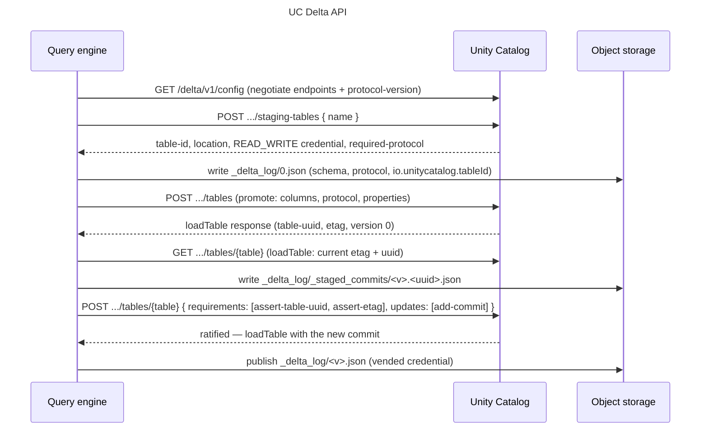

## Companion files

CI-tested scripts that run this page's examples end to end. A script that exits 0 has passed its checks.

They need Unity Catalog 0.7.0 running. To start it (also `environment` in this file's frontmatter):

```bash
curl -fsSL https://unitycatalog.io/docs/env/unitycatalog.tar.gz | tar -xz
cd uc-docs-env/unitycatalog && docker compose up -d --wait
export UNITY_CATALOG_URL=http://localhost:8080/api/2.1/unity-catalog
```

- [`delta_api_semantics.py`](https://unitycatalog.io/docs/explanation/delta-api/snippets/delta_api_semantics.py) (Python): How the Unity Catalog Delta API behaves on the wire, with plain HTTP. It is
  - run: `UNITY_CATALOG_URL=http://localhost:8080/api/2.1/unity-catalog uv run https://unitycatalog.io/docs/explanation/delta-api/snippets/delta_api_semantics.py`

The *Delta API* is a versioned REST interface that [Unity Catalog](https://unitycatalog.io/docs/explanation/what-is-unity-catalog/ "The open-source reference server implementing the Unity Catalog specification.") serves under `/api/2.1/unity-catalog/delta/v1/`, next to the Unity Catalog REST API's `/tables` endpoints. A [Delta](https://delta.io "Open table-format specification: ACID transactions, schema evolution, and time travel over object storage.") client uses it to stage, create, load, and commit to a catalog-managed Delta table. [External tables and catalog-managed Delta tables](https://unitycatalog.io/docs/explanation/external-and-managed-tables/) walks through that lifecycle. This page explains why each part of the API is designed the way it is.

The diagram follows one table through the API, from negotiation to its first commit. Expand it to step through each call:

A query engine negotiates with GET /delta/v1/config, stages a table and gets back its location, a READ\_WRITE credential, and the required protocol, writes version 0 to object storage, creates the table, then loads it, writes a staged commit, and posts that commit with assert-table-uuid and assert-etag before publishing it to the Delta log



This page's script, `delta_api_semantics.py`, sends the requests shown here to a server and checks the responses the page describes.

## One endpoint takes requirements and updates

A commit proposal and every metadata change to a table go to one endpoint, `POST …/tables/{table}`, as a list of preconditions (`requirements`) and a list of intents (`updates`). Dropping and renaming a table have endpoints of their own. The server checks every requirement, then applies every update, or applies none. A request that sets a comment and a property looks like this:

`update-request.json`

```json
{
  "requirements": [
    { "type": "assert-table-uuid", "uuid": "<table-uuid>" },
    { "type": "assert-etag", "etag": "<etag>" }
  ],
  "updates": [
    { "action": "set-table-comment", "comment": "One row per order" },
    { "action": "set-properties", "updates": { "sales.owner": "orders-team" } }
  ]
}
```

The same envelope carries a new commit (`add-commit`), a schema change, a protocol upgrade, and a property change. They can share one request, so a change and the commit that writes it land together or not at all.

All or nothing extends to a request the server rejects as malformed. A request may carry at most one update of each action type, `add-commit` included, and at most one requirement of each type ([spec](https://github.com/unitycatalog/unitycatalog/blob/v0.7.0/spec/protocols/ManagedDeltaTablesSpec.md#write-a-commit), [`delta.yaml`](https://github.com/unitycatalog/unitycatalog/blob/v0.7.0/api/delta.yaml)). The file actions a writer repeats, Delta's `add` and `remove`, aren't actions in this API. They live in the commit file that the one `add-commit` names, and a commit file holds as many as the commit needs. A `set-properties` and a `remove-properties` that touch the same key are rejected rather than applied in order. The order of entries in either list carries no meaning, because the server applies actions in a fixed order of its own ([spec](https://github.com/unitycatalog/unitycatalog/blob/v0.7.0/spec/protocols/ManagedDeltaTablesSpec.md#write-a-commit)). When the server rejects one, none of its valid updates apply either, and the table's etag stays the same.

## Negotiation comes first

Before any other request, a client asks `GET /delta/v1/config` with a `catalog` and the `protocol-versions` it supports. Both parameters are required, and a missing one is a 400. The answer names a protocol version and the endpoints the server offers for it:

`config-response.json (condensed)`

```json
{
  "endpoints": [
    "POST /v1/catalogs/warehouse/schemas/{schema}/staging-tables",
    "GET /v1/catalogs/warehouse/schemas/{schema}/tables/{table}",
    "POST /v1/catalogs/warehouse/schemas/{schema}/tables/{table}",
    "GET /v1/staging-tables/{table_id}/credentials"
  ],
  "protocol-version": "1.0"
}
```

The endpoints come back as strings, and clients route by them instead of building paths. The strings carry the resolved catalog name, `warehouse` here, while the schema and table segments stay templates. That design leaves room to change the API:

- The version lives in each returned path (`/v1/…`), so a later protocol version can lay out its paths however it needs.
- A server may list endpoints beyond the specification's. Clients ignore strings they don't recognize, so a new endpoint doesn't break an old client.
- The [specification](https://github.com/unitycatalog/unitycatalog/blob/v0.7.0/spec/protocols/ManagedDeltaTablesSpec.md#get-configuration) treats a 404 on `config` as a server that doesn't support the protocol, and tells the client to fall back to the Unity Catalog table APIs. An unknown catalog is also a 404. Its error type, `NoSuchCatalogException`, tells the two apart.

The specification defines a negotiation: the client offers the highest version it supports per major version, and the server picks the highest version both support. The Unity Catalog server doesn't negotiate. It ignores `protocol-versions` and answers `1.0` whatever the client offers, even `2.0` alone. Check that the returned `protocol-version` is one you offered. Treat any other answer as an unsupported server, as the specification does for a 400.

`config` covers the protocol version and its endpoints, not table features. The catalog states those when a table is staged.

## The catalog sets table features at staging

When a client stages a table, the catalog states the Delta protocol the table must use: a required protocol and properties, and a suggested protocol and properties. Condensed, the server's answer reads:

`staging-response.json (condensed)`

```json
{
  "table-id": "<table-id>",
  "location": "<location>",
  "storage-credentials": [
    { "prefix": "<location>", "operation": "READ_WRITE" }
  ],
  "required-protocol": {
    "min-reader-version": 3,
    "min-writer-version": 7,
    "reader-features": ["catalogManaged", "v2Checkpoint", "vacuumProtocolCheck", "deletionVectors"],
    "writer-features": ["catalogManaged", "v2Checkpoint", "vacuumProtocolCheck", "deletionVectors", "inCommitTimestamp"]
  },
  "suggested-protocol": {
    "reader-features": ["columnMapping"],
    "writer-features": ["columnMapping", "domainMetadata", "rowTracking"]
  },
  "required-properties": {
    "delta.enableInCommitTimestamps": "true",
    "io.unitycatalog.tableId": "<table-id>"
  },
  "suggested-properties": {
    "delta.columnMapping.mode": "name",
    "delta.columnMapping.maxColumnId": null
  }
}
```

The required protocol is reader version 3 and writer version 7. Its reader and writer features are `catalogManaged`, `v2Checkpoint`, `vacuumProtocolCheck`, and `deletionVectors`, and the writer features add `inCommitTimestamp`. The required properties include `io.unitycatalog.tableId`, which equals the staging table's ID.

A `null` value means the engine generates the value. The catalog asks for column mapping in `name` mode but leaves `delta.columnMapping.maxColumnId` to the engine that assigns the column IDs. The catalog names the property, and the engine, which knows the schema, fills it in.

The response is authoritative. The specification's [list of features](https://github.com/unitycatalog/unitycatalog/blob/v0.7.0/spec/protocols/ManagedDeltaTablesSpec.md#reference-table-features-and-properties-for-unity-catalog-managed-tables) is a non-normative reference, and the specification lets a catalog grow or shrink the set. Clients read the response fields rather than hard-coding a list. A catalog that serves a stateful compaction service, for example, may require `domainMetadata` so that the service's state is kept with the table. Unity Catalog OSS ships a fixed set, defined in [`UcManagedDeltaContract.java`](https://github.com/unitycatalog/unitycatalog/blob/v0.7.0/server/src/main/java/io/unitycatalog/server/service/delta/UcManagedDeltaContract.java). When the client then creates the table, the server checks the declared protocol and properties against the managed-table contract.

The staging response also carries one `READ_WRITE` credential whose prefix is the table's location, so the engine can write version 0 without standing access to the bucket. [Credential vending](https://unitycatalog.io/docs/explanation/credential-vending/) explains that trust boundary.

## Optimistic concurrency with assert-table-uuid and assert-etag

The API doesn't lock tables. A writer loads the table, prepares its change, and states in `requirements` what it assumed when it loaded:

- **`assert-table-uuid`** is required on every request. A request without it is a 400 (`assert-table-uuid requirement is required`). Names get reused: a table can be dropped and created again under the same name. UUIDs don't, so the assertion stops a change meant for the old table from landing on the new one.
- **`assert-etag`** is optional. The etag is an opaque token from `loadTable`. If the table has changed since, the server answers 409 `UpdateRequirementConflictException` and applies nothing:

  `conflict-response.json`

  ```json
  {
    "error": {
      "type": "UpdateRequirementConflictException",
      "code": 409,
      "message": "<assert-etag failed: expected … but table has …>"
    }
  }
  ```

An `add-commit` for version `v` also asserts, without saying so, that the table is at version `v-1`. Commits go in order, one version at a time: after a Spark `INSERT`, the table's latest version is one higher, and its newest commit carries that version. When another writer has already taken the version, the [specification](https://github.com/unitycatalog/unitycatalog/blob/v0.7.0/spec/protocols/ManagedDeltaTablesSpec.md#write-a-commit) defines a second 409, `CommitVersionConflictException`. So a 409 comes in two kinds: the version was taken, or a requirement failed. Either way, the change didn't land.

### Retry or rebase

The two kinds of failure call for different responses. The specification's [commit recovery](https://github.com/unitycatalog/unitycatalog/blob/v0.7.0/spec/protocols/ManagedDeltaTablesSpec.md#commit-recovery) rules say:

- **On a 5xx or a timeout, resend the identical request.** The outcome is unknown, and the server deduplicates a retry by the staged commit's file name. A byte-for-byte retry resolves to what happened the first time.
- **Rebase only once you know the attempt didn't land.** A 409 tells you, and so does a reload that shows another writer's commit at the proposed version. Rebasing means building the commit again against the reloaded state, with a new commit file. Rebasing while the outcome is unknown can commit the same change twice.
- **Abort if the reloaded UUID differs.** The table was dropped and created again under the same name, so the change no longer has a target.

## Metadata changes travel with add-commit

A catalog-managed table has two views of its metadata: the catalog's record and the Delta log. The API keeps them in lockstep with one rule. A change that the Delta log also represents, such as the schema, the protocol, or a `delta.*` property, goes in the same request as the `add-commit` whose commit file writes it. A change that lives only in the catalog, such as the table comment, may go alone. Engines follow the rule: after a Spark `ALTER TABLE … ADD COLUMNS`, the table's version is one higher, and both the Delta API and the Unity Catalog REST API list the new column.

The rule falls on the client. The specification doesn't require the server to inspect staged commit files ([spec](https://github.com/unitycatalog/unitycatalog/blob/v0.7.0/spec/protocols/ManagedDeltaTablesSpec.md#catalog-and-log-consistency)), so clients can't rely on it to check that declared metadata matches the commit file, and they own the consistency of the two views. If the two views diverge anyway, the Delta log wins for snapshots: engines rebuild the table from its commits, and the catalog's record serves discovery.

> **Warning**
>
> The server accepts a log-represented change with no commit. A `set-properties` that turns `delta.enableDeletionVectors` off on a managed table succeeds without a new version, and the Delta log keeps the old value. The specification calls such a request a client error. Don't rely on the server to catch it: send log-represented changes only with the `add-commit` that writes them.

An external table has no `add-commit`, because the catalog doesn't accept its commits. Its sync is metadata-only: the client sends what it reads from the Delta log to the catalog's record, as in [Sync the catalog's record](https://unitycatalog.io/docs/how-to/change-table-schema/#sync-the-catalogs-record).

## Delta's own schema on the wire

The Delta API sends a table's columns as a Delta struct type, the same shape as `metaData.schemaString` in the Delta log. Column-mapping metadata travels with each field:

`columns-response.json (one field)`

```json
{
  "metadata": {
    "columns": {
      "type": "struct",
      "fields": [
        {
          "name": "order_id",
          "type": "long",
          "nullable": true,
          "metadata": {
            "delta.columnMapping.id": 1,
            "delta.columnMapping.physicalName": "<physical-name>"
          }
        }
      ]
    }
  }
}
```

The protocol travels the same way, as reader and writer features. Nothing is translated: an engine gets the schema in the shape it writes to the log, with the column IDs and physical names it assigned.

Compare the Unity Catalog REST API, which describes each column as a `ColumnInfo` with `type_name`, `type_text`, and `type_json`. That shape serves every format the catalog registers. The Delta API serves only Delta tables, so it uses Delta's own shapes.

## Further reading

- [External tables and catalog-managed Delta tables](https://unitycatalog.io/docs/explanation/external-and-managed-tables/) walks through the lifecycle of a catalog-managed table.
- [Credential vending](https://unitycatalog.io/docs/explanation/credential-vending/) explains the credentials the staging and table responses carry.
- [Manage schemas and properties](https://unitycatalog.io/docs/how-to/change-table-schema/) uses the Delta API to sync an external table's record.
- The [managed Delta tables specification](https://github.com/unitycatalog/unitycatalog/blob/v0.7.0/spec/protocols/ManagedDeltaTablesSpec.md) defines the protocol, and the [Delta API definition](https://github.com/unitycatalog/unitycatalog/blob/v0.7.0/api/delta.yaml) defines every endpoint and field.
- The [Delta protocol](https://github.com/delta-io/delta/blob/v4.3.1/PROTOCOL.md#catalog-managed-tables) defines catalog-managed tables from the table's side.
