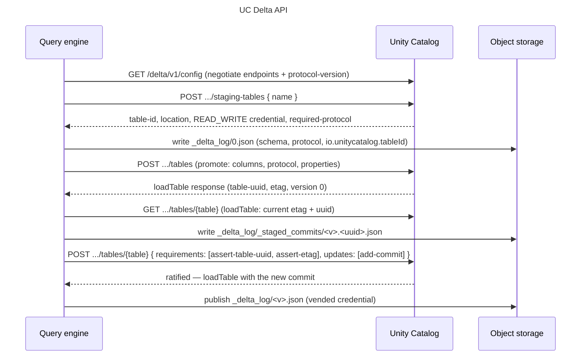

Unity Catalog knows two kinds of table. They differ in two things: who owns the files, and who decides which version of the table is the current one. This page explains both kinds, what the server does for a catalog-managed [Delta](https://delta.io "Open table-format specification: ACID transactions, schema evolution, and time travel over object storage.") table, and which engines can use each kind.

## Two questions decide the kind

**Who owns the files?** An *external* table points at a location that someone else chose and controls. The catalog records the table's name, columns, format, and location, and never moves or deletes the files. A *managed* table lives at a location the catalog chooses, under the storage root of its schema or catalog. The catalog creates that location, and deletes it when the table is dropped.

**Who decides the latest version?** A Delta table is a series of numbered commits in its `_delta_log`. For an external table, the files decide: whichever writer manages to put commit file `N` in place first has made version `N`, and the catalog plays no part. For a *catalog-managed* Delta table, the catalog decides. A writer proposes commit `N`, and it becomes the table's version `N` only once the server accepts it.

In Unity Catalog the two answers go together. Managed tables are always Delta, and a client that creates one through the Delta API, such as Spark with Delta 4.3 or later, makes it catalog-managed. External tables never are.

|                     | External table                                                              | Managed (catalog-managed Delta) table                                                            |
| ------------------- | --------------------------------------------------------------------------- | ------------------------------------------------------------------------------------------------ |
| Location            | You supply it                                                               | The catalog allocates it                                                                         |
| Who accepts commits | The files, first writer wins                                                | The Unity Catalog server                                                                         |
| Formats             | Delta, Parquet, CSV, and others                                             | Delta only                                                                                       |
| Dropping the table  | Removes the catalog entry, keeps the files                                  | Deletes the files too, after a cleanup delay                                                     |
| Path-based clients  | Can read and write the location                                             | Can't load it without the catalog                                                                |
| How to create one   | [Register it](https://unitycatalog.io/docs/how-to/register-external-table/) | [`CREATE TABLE` without a location](https://unitycatalog.io/docs/tutorials/managed-delta-table/) |

## Why a catalog should accept commits

When the files decide, the storage system has to resolve races between writers, and every guarantee follows from that one atomic file operation. That has worked for years, but it leaves the catalog as a bystander. The catalog can't reject a commit that breaks a rule, can't see a commit before it lands, and can't coordinate changes across tables.

When the catalog accepts commits, it becomes the table's source of truth. Two writers that race for the same version get one acceptance and one rejection, whatever the storage system offers. The catalog can require table features, such as deletion vectors or in-commit timestamps, before a table may exist. A reader asks the catalog for the latest version instead of listing files.

Delta records this arrangement in the table itself as the `catalogManaged` table feature. The [Delta protocol](https://github.com/delta-io/delta/blob/v4.3.1/PROTOCOL.md#catalog-managed-tables) requires every client that reads or writes such a table to ask the catalog.

## The lifecycle through the Delta API

The server speaks to Delta clients through the *Delta API*, a versioned REST interface under `/api/2.1/unity-catalog/delta/v1/`. Its [managed-tables protocol](https://github.com/unitycatalog/unitycatalog/blob/v0.7.0/spec/protocols/ManagedDeltaTablesSpec.md) defines each step. Expand the diagram and step through it:

The managed-table lifecycle through the Delta API



The lifecycle has four parts.

1. **Negotiate.** The client asks `GET /delta/v1/config` which endpoints and which protocol version the server supports. The server answers with the endpoints it implements and protocol version `1.0`.
2. **Stage.** To create a table, the client asks for a *staging table*. The server picks the location, issues a read-write credential for it, and states the Delta protocol the table must use. The server answers like this:

   ```json
   {
     "table-type": "MANAGED",
     "location": "file:///tmp/uc-docs/managed/__unitystorage/catalogs/<catalog-id>/tables/<table-id>",
     "required-protocol": {
       "min-reader-version": 3,
       "min-writer-version": 7,
       "reader-features": ["catalogManaged", "v2Checkpoint", "vacuumProtocolCheck", "deletionVectors"],
       "writer-features": ["catalogManaged", "v2Checkpoint", "vacuumProtocolCheck", "deletionVectors", "inCommitTimestamp"]
     },
     "suggested-protocol": {
       "reader-features": ["columnMapping"],
       "writer-features": ["columnMapping", "domainMetadata", "rowTracking"]
     }
   }
   ```

   The response also lists the matching required and suggested table properties. The client writes version 0 of the Delta log at that location, then asks the server to turn the staging table into a real one.
3. **Commit.** For each change, the client writes the new data files and a commit file under `_delta_log/_staged_commits/`, named with the version and a random ID. It then sends one request that names the commit and the conditions under which to accept it, for example that the table is still the one it loaded. The server checks the conditions and accepts or rejects the commit as a whole.
4. **Load.** A reader asks the server for the table. The response includes the latest accepted version and the recent commits, so the reader knows exactly which files make up the table.

Throughout, the server hands out storage credentials scoped to the table's location, so no client needs standing access to the whole bucket. See [Credential vending](https://unitycatalog.io/docs/explanation/credential-vending/) for that trust boundary.

## What clients must support

Because the protocol lives in the table, a client that doesn't speak it can't use the table at all, not even to read it. Unity Catalog gives a path-based client nothing to work with: delta-rs 1.6.6, pointed at a managed table's location, stops with `Max catalog version is required when loading a catalog-managed table`. That refusal is deliberate. A client that only lists files could miss commits the catalog has accepted, or write a version the catalog never approved.

So for a managed table, choose a client that goes through the catalog. These include Spark with the Unity Catalog connector and Delta 4.3 or later, and DuckDB's `unity_catalog` extension for reads and appends.

An external table makes the opposite trade. Any client with access to the storage can read and write it, including tools that have never heard of Unity Catalog. That suits data that another system already owns. But the catalog can't coordinate those writers, and its record of the columns can fall out of step with the files.

What each client can do with a table, as tested in CI:

| Operation                                  | [Spark 4.1](https://spark.apache.org "Unified analytics engine for large-scale data processing.")                                                   | [DuckDB](https://duckdb.org "In-process analytical SQL engine.")                                                | [Polars](https://pola.rs "Fast DataFrame library written in Rust, with a Python API.")                          | [Daft](https://docs.daft.ai/en/stable/connectors/unity_catalog/ "Distributed Python DataFrame library with a Unity Catalog integration.") | [pandas](https://delta-io.github.io/delta-rs/ "Native Rust implementation of the Delta protocol with Python bindings.") | [PyIceberg](https://py.iceberg.apache.org "Python implementation of Apache Iceberg with REST catalog and table APIs.") | [DataFusion · Rust](https://datafusion.apache.org "Extensible, high-performance query engine in Rust using Apache Arrow.") | [uc CLI 0.7](https://docs.unitycatalog.io/how-to/run-local-server#run-the-uc-cli "Command-line client for managing Unity Catalog objects and storage access.") | [Python SDK 0.7](https://pypi.org/project/unitycatalog-client/ "Generated asynchronous Python client for Unity Catalog REST APIs.") |
| ------------------------------------------ | --------------------------------------------------------------------------------------------------------------------------------------------------- | --------------------------------------------------------------------------------------------------------------- | --------------------------------------------------------------------------------------------------------------- | ----------------------------------------------------------------------------------------------------------------------------------------- | ----------------------------------------------------------------------------------------------------------------------- | ---------------------------------------------------------------------------------------------------------------------- | -------------------------------------------------------------------------------------------------------------------------- | -------------------------------------------------------------------------------------------------------------------------------------------------------------- | ----------------------------------------------------------------------------------------------------------------------------------- |
| List tables                                | [✓](https://unitycatalog.io/docs/how-to/configure-spark/#check-the-connection)                                                                      | [✓](https://unitycatalog.io/docs/how-to/duckdb/#list-tables)                                                    | [✓](https://unitycatalog.io/docs/how-to/python-dataframes/#list-tables)                                         | [✓](https://unitycatalog.io/docs/how-to/python-dataframes/#list-tables)                                                                   | ✗                                                                                                                       | —                                                                                                                      | —                                                                                                                          | [✓](https://unitycatalog.io/docs/tutorials/getting-started/#browse-the-sample-data)                                                                            | —                                                                                                                                   |
| Read an external table                     | —                                                                                                                                                   | [✓](https://unitycatalog.io/docs/how-to/register-external-table/#read-the-data)                                 | [✓](https://unitycatalog.io/docs/how-to/register-external-table/#read-the-data)                                 | [✓](https://unitycatalog.io/docs/how-to/register-external-table/#read-the-data)                                                           | [✓](https://unitycatalog.io/docs/how-to/python-dataframes/#read-a-table)                                                | —                                                                                                                      | —                                                                                                                          | —                                                                                                                                                              | —                                                                                                                                   |
| Read with vended S3 credentials            | —                                                                                                                                                   | —                                                                                                               | [✓](https://unitycatalog.io/docs/how-to/python-dataframes/#read-a-table)                                        | —                                                                                                                                         | [✓](https://unitycatalog.io/docs/how-to/python-dataframes/#read-a-table)                                                | —                                                                                                                      | —                                                                                                                          | —                                                                                                                                                              | —                                                                                                                                   |
| Append to an external table                | —                                                                                                                                                   | —                                                                                                               | [✓](https://unitycatalog.io/docs/how-to/python-dataframes/#append-rows)                                         | [✗](https://unitycatalog.io/docs/how-to/python-dataframes/#append-rows) on local storage                                                  | [✓](https://unitycatalog.io/docs/how-to/python-dataframes/#append-rows)                                                 | —                                                                                                                      | —                                                                                                                          | —                                                                                                                                                              | —                                                                                                                                   |
| Create a managed table                     | [✓](https://unitycatalog.io/docs/how-to/managed-delta-tables/#create-a-managed-table)                                                               | [✓](https://unitycatalog.io/docs/how-to/duckdb/#create-change-and-drop-tables)                                  | —                                                                                                               | —                                                                                                                                         | —                                                                                                                       | —                                                                                                                      | —                                                                                                                          | —                                                                                                                                                              | —                                                                                                                                   |
| Create a managed table from a query        | [✓](https://unitycatalog.io/docs/how-to/replace-and-overwrite-tables/#create-a-table-from-a-query)                                                  | ✗                                                                                                               | —                                                                                                               | —                                                                                                                                         | —                                                                                                                       | —                                                                                                                      | —                                                                                                                          | —                                                                                                                                                              | —                                                                                                                                   |
| Read a managed table                       | [✓](https://unitycatalog.io/docs/how-to/managed-delta-tables/#read-the-table)                                                                       | [✓](https://unitycatalog.io/docs/how-to/duckdb/#query-a-table)                                                  | [✗](https://unitycatalog.io/docs/how-to/python-dataframes/#other-table-operations)                              | [✗](https://unitycatalog.io/docs/how-to/python-dataframes/#other-table-operations)                                                        | [✗](https://unitycatalog.io/docs/how-to/python-dataframes/#other-table-operations)                                      | —                                                                                                                      | —                                                                                                                          | —                                                                                                                                                              | —                                                                                                                                   |
| Append to a managed table                  | [✓](https://unitycatalog.io/docs/how-to/managed-delta-tables/#write-to-the-table)                                                                   | [✓](https://unitycatalog.io/docs/how-to/duckdb/#append-rows)                                                    | [✗](https://unitycatalog.io/docs/how-to/python-dataframes/#other-table-operations)                              | [✗](https://unitycatalog.io/docs/how-to/python-dataframes/#other-table-operations) on local storage                                       | [✗](https://unitycatalog.io/docs/how-to/python-dataframes/#other-table-operations)                                      | —                                                                                                                      | —                                                                                                                          | —                                                                                                                                                              | —                                                                                                                                   |
| Update rows in a managed table             | [✓](https://unitycatalog.io/docs/how-to/managed-delta-tables/#write-to-the-table)                                                                   | [✗](https://unitycatalog.io/docs/how-to/duckdb/#create-change-and-drop-tables)                                  | —                                                                                                               | —                                                                                                                                         | —                                                                                                                       | —                                                                                                                      | —                                                                                                                          | —                                                                                                                                                              | —                                                                                                                                   |
| Delete rows from a managed table           | [✓](https://unitycatalog.io/docs/how-to/managed-delta-tables/#write-to-the-table)                                                                   | [✗](https://unitycatalog.io/docs/how-to/duckdb/#create-change-and-drop-tables)                                  | —                                                                                                               | —                                                                                                                                         | —                                                                                                                       | —                                                                                                                      | —                                                                                                                          | —                                                                                                                                                              | —                                                                                                                                   |
| Change a managed table's columns           | [✓](https://unitycatalog.io/docs/how-to/change-table-schema/#add-columns-and-comments)                                                              | [✗](https://unitycatalog.io/docs/how-to/change-table-schema/#choose-a-client)                                   | ✗                                                                                                               | ✗                                                                                                                                         | ✗                                                                                                                       | —                                                                                                                      | —                                                                                                                          | ✗                                                                                                                                                              | ✗                                                                                                                                   |
| Set a managed table's properties           | [✓](https://unitycatalog.io/docs/how-to/change-table-schema/#set-and-remove-table-properties)                                                       | —                                                                                                               | ✗                                                                                                               | ✗                                                                                                                                         | ✗                                                                                                                       | —                                                                                                                      | —                                                                                                                          | ✗                                                                                                                                                              | ✗                                                                                                                                   |
| Rename a managed table or column           | [✗](https://unitycatalog.io/docs/how-to/change-table-schema/#rename-a-table-or-column)                                                              | —                                                                                                               | —                                                                                                               | —                                                                                                                                         | —                                                                                                                       | —                                                                                                                      | —                                                                                                                          | —                                                                                                                                                              | —                                                                                                                                   |
| Change an external table's columns         | [✓](https://unitycatalog.io/docs/how-to/change-table-schema/#change-the-delta-log) sync through the Delta API                                       | [✗](https://unitycatalog.io/docs/how-to/change-table-schema/#choose-a-client)                                   | —                                                                                                               | —                                                                                                                                         | —                                                                                                                       | —                                                                                                                      | —                                                                                                                          | —                                                                                                                                                              | —                                                                                                                                   |
| Set an external table's properties         | [✓](https://unitycatalog.io/docs/how-to/change-table-schema/#change-the-delta-log) sync through the Delta API                                       | [✗](https://unitycatalog.io/docs/how-to/change-table-schema/#choose-a-client)                                   | —                                                                                                               | —                                                                                                                                         | —                                                                                                                       | —                                                                                                                      | —                                                                                                                          | —                                                                                                                                                              | —                                                                                                                                   |
| Replace a managed table                    | [✓](https://unitycatalog.io/docs/how-to/replace-and-overwrite-tables/#replace-a-tables-definition-and-rows)                                         | —                                                                                                               | —                                                                                                               | —                                                                                                                                         | —                                                                                                                       | —                                                                                                                      | —                                                                                                                          | —                                                                                                                                                              | —                                                                                                                                   |
| Overwrite a managed table                  | [✓](https://unitycatalog.io/docs/how-to/replace-and-overwrite-tables/#overwrite-all-rows)                                                           | —                                                                                                               | —                                                                                                               | —                                                                                                                                         | —                                                                                                                       | —                                                                                                                      | —                                                                                                                          | —                                                                                                                                                              | —                                                                                                                                   |
| Replace rows that match a condition        | [✓](https://unitycatalog.io/docs/how-to/replace-and-overwrite-tables/#replace-the-rows-that-match-a-condition)                                      | —                                                                                                               | —                                                                                                               | —                                                                                                                                         | —                                                                                                                       | —                                                                                                                      | —                                                                                                                          | —                                                                                                                                                              | —                                                                                                                                   |
| Overwrite partitions of a managed table    | [✓](https://unitycatalog.io/docs/how-to/replace-and-overwrite-tables/#overwrite-the-partitions-the-new-rows-write-to)                               | —                                                                                                               | —                                                                                                               | —                                                                                                                                         | —                                                                                                                       | —                                                                                                                      | —                                                                                                                          | —                                                                                                                                                              | —                                                                                                                                   |
| Drop a managed table                       | [✓](https://unitycatalog.io/docs/how-to/managed-delta-tables/#drop-a-managed-table)                                                                 | [✗](https://unitycatalog.io/docs/how-to/duckdb/#create-change-and-drop-tables)                                  | —                                                                                                               | —                                                                                                                                         | —                                                                                                                       | —                                                                                                                      | —                                                                                                                          | —                                                                                                                                                              | —                                                                                                                                   |
| Read an earlier version of a managed table | [✓](https://unitycatalog.io/docs/how-to/managed-delta-tables/#read-an-earlier-version)                                                              | —                                                                                                               | —                                                                                                               | —                                                                                                                                         | —                                                                                                                       | —                                                                                                                      | —                                                                                                                          | —                                                                                                                                                              | —                                                                                                                                   |
| Write to a managed table by path           | [✗](https://unitycatalog.io/docs/how-to/managed-delta-tables/#dont-write-to-the-tables-path)                                                        | —                                                                                                               | ✗                                                                                                               | ✗                                                                                                                                         | ✗                                                                                                                       | —                                                                                                                      | —                                                                                                                          | —                                                                                                                                                              | —                                                                                                                                   |
| Read a Parquet, CSV, or JSON table         | —                                                                                                                                                   | [✓](https://unitycatalog.io/docs/how-to/table-storage-formats/#read-the-data) by path from the table's location | [✓](https://unitycatalog.io/docs/how-to/table-storage-formats/#read-the-data) by path from the table's location | —                                                                                                                                         | —                                                                                                                       | —                                                                                                                      | —                                                                                                                          | —                                                                                                                                                              | —                                                                                                                                   |
| Create a managed Iceberg table             | [✓](https://unitycatalog.io/docs/how-to/iceberg-rest/#create-a-table)                                                                               | [✓](https://unitycatalog.io/docs/how-to/iceberg-rest/#create-a-table)                                           | —                                                                                                               | —                                                                                                                                         | —                                                                                                                       | [✓](https://unitycatalog.io/docs/how-to/iceberg-rest/#create-a-table)                                                  | [✓](https://unitycatalog.io/docs/how-to/iceberg-rest/#create-a-table)                                                      | —                                                                                                                                                              | —                                                                                                                                   |
| Append to an Iceberg table                 | [✓](https://unitycatalog.io/docs/how-to/iceberg-rest/#write-and-read-rows)                                                                          | [✓](https://unitycatalog.io/docs/how-to/iceberg-rest/#write-and-read-rows)                                      | —                                                                                                               | —                                                                                                                                         | —                                                                                                                       | [✓](https://unitycatalog.io/docs/how-to/iceberg-rest/#write-and-read-rows)                                             | [✓](https://unitycatalog.io/docs/how-to/iceberg-rest/#write-and-read-rows)                                                 | —                                                                                                                                                              | —                                                                                                                                   |
| Read an Iceberg table                      | [✓](https://unitycatalog.io/docs/how-to/iceberg-rest/#write-and-read-rows)                                                                          | [✓](https://unitycatalog.io/docs/how-to/iceberg-rest/#write-and-read-rows)                                      | —                                                                                                               | —                                                                                                                                         | —                                                                                                                       | [✓](https://unitycatalog.io/docs/how-to/iceberg-rest/#write-and-read-rows)                                             | [✓](https://unitycatalog.io/docs/how-to/iceberg-rest/#write-and-read-rows)                                                 | —                                                                                                                                                              | —                                                                                                                                   |
| Update rows in an Iceberg table            | [✓](https://unitycatalog.io/docs/how-to/iceberg-rest/#update-and-delete-rows)                                                                       | [✓](https://unitycatalog.io/docs/how-to/iceberg-rest/#update-and-delete-rows)                                   | —                                                                                                               | —                                                                                                                                         | —                                                                                                                       | [✓](https://unitycatalog.io/docs/how-to/iceberg-rest/#update-and-delete-rows)                                          | [✗](https://unitycatalog.io/docs/how-to/iceberg-rest/#update-and-delete-rows)                                              | —                                                                                                                                                              | —                                                                                                                                   |
| Delete rows from an Iceberg table          | [✓](https://unitycatalog.io/docs/how-to/iceberg-rest/#update-and-delete-rows)                                                                       | [✓](https://unitycatalog.io/docs/how-to/iceberg-rest/#update-and-delete-rows)                                   | —                                                                                                               | —                                                                                                                                         | —                                                                                                                       | [✓](https://unitycatalog.io/docs/how-to/iceberg-rest/#update-and-delete-rows)                                          | [✗](https://unitycatalog.io/docs/how-to/iceberg-rest/#update-and-delete-rows)                                              | —                                                                                                                                                              | —                                                                                                                                   |
| Merge into an Iceberg table                | [✓](https://unitycatalog.io/docs/how-to/iceberg-rest/#update-and-delete-rows)                                                                       | —                                                                                                               | —                                                                                                               | —                                                                                                                                         | —                                                                                                                       | —                                                                                                                      | —                                                                                                                          | —                                                                                                                                                              | —                                                                                                                                   |
| Rename an Iceberg table                    | [✓](https://unitycatalog.io/docs/how-to/iceberg-rest/#rename-and-drop-a-table)                                                                      | [✓](https://unitycatalog.io/docs/how-to/iceberg-rest/#rename-and-drop-a-table)                                  | —                                                                                                               | —                                                                                                                                         | —                                                                                                                       | [✓](https://unitycatalog.io/docs/how-to/iceberg-rest/#rename-and-drop-a-table)                                         | [✓](https://unitycatalog.io/docs/how-to/iceberg-rest/#rename-and-drop-a-table)                                             | —                                                                                                                                                              | —                                                                                                                                   |
| Move an Iceberg table to another schema    | ✗                                                                                                                                                   | ✗                                                                                                               | ✗                                                                                                               | ✗                                                                                                                                         | —                                                                                                                       | ✗                                                                                                                      | —                                                                                                                          | —                                                                                                                                                              | —                                                                                                                                   |
| Drop an Iceberg table                      | [✓](https://unitycatalog.io/docs/how-to/iceberg-rest/#rename-and-drop-a-table)                                                                      | [✓](https://unitycatalog.io/docs/how-to/iceberg-rest/#rename-and-drop-a-table)                                  | —                                                                                                               | —                                                                                                                                         | —                                                                                                                       | [✓](https://unitycatalog.io/docs/how-to/iceberg-rest/#rename-and-drop-a-table)                                         | [✓](https://unitycatalog.io/docs/how-to/iceberg-rest/#rename-and-drop-a-table)                                             | —                                                                                                                                                              | —                                                                                                                                   |
| Join Delta and Iceberg tables              | [✓](https://unitycatalog.io/docs/how-to/iceberg-rest/#join-delta-and-iceberg-tables-in-spark) UC connector and Iceberg REST catalogs in one session | —                                                                                                               | —                                                                                                               | —                                                                                                                                         | —                                                                                                                       | —                                                                                                                      | —                                                                                                                          | —                                                                                                                                                              | —                                                                                                                                   |
| Read a Delta table as Iceberg              | ✗                                                                                                                                                   | ✗                                                                                                               | —                                                                                                               | —                                                                                                                                         | —                                                                                                                       | ✗                                                                                                                      | —                                                                                                                          | —                                                                                                                                                              | —                                                                                                                                   |
| Register an existing Iceberg table         | ✗                                                                                                                                                   | ✗                                                                                                               | ✗                                                                                                               | ✗                                                                                                                                         | —                                                                                                                       | ✗                                                                                                                      | ✗                                                                                                                          | —                                                                                                                                                              | —                                                                                                                                   |
| Commit to several tables at once           | ✗                                                                                                                                                   | ✗                                                                                                               | ✗                                                                                                               | ✗                                                                                                                                         | —                                                                                                                       | ✗                                                                                                                      | ✗                                                                                                                          | —                                                                                                                                                              | —                                                                                                                                   |
| Create and query Iceberg views             | ✗                                                                                                                                                   | ✗                                                                                                               | ✗                                                                                                               | ✗                                                                                                                                         | —                                                                                                                       | ✗                                                                                                                      | ✗                                                                                                                          | —                                                                                                                                                              | —                                                                                                                                   |
| Plan scans on the server                   | ✗                                                                                                                                                   | ✗                                                                                                               | ✗                                                                                                               | ✗                                                                                                                                         | —                                                                                                                       | ✗                                                                                                                      | ✗                                                                                                                          | —                                                                                                                                                              | —                                                                                                                                   |
| Sign storage requests through the catalog  | ✗                                                                                                                                                   | ✗                                                                                                               | ✗                                                                                                               | ✗                                                                                                                                         | —                                                                                                                       | ✗                                                                                                                      | ✗                                                                                                                          | —                                                                                                                                                              | —                                                                                                                                   |
| Register an external Delta table           | —                                                                                                                                                   | —                                                                                                               | —                                                                                                               | —                                                                                                                                         | —                                                                                                                       | —                                                                                                                      | —                                                                                                                          | [✓](https://unitycatalog.io/docs/how-to/register-external-table/#register-the-table)                                                                           | [✓](https://unitycatalog.io/docs/how-to/register-external-table/#register-the-table)                                                |
| Register a Parquet, CSV, or JSON table     | —                                                                                                                                                   | —                                                                                                               | —                                                                                                               | —                                                                                                                                         | —                                                                                                                       | —                                                                                                                      | —                                                                                                                          | [✓](https://unitycatalog.io/docs/how-to/table-storage-formats/#register-the-tables)                                                                            | [✓](https://unitycatalog.io/docs/how-to/table-storage-formats/#register-the-tables)                                                 |
| View a table                               | —                                                                                                                                                   | —                                                                                                               | —                                                                                                               | —                                                                                                                                         | —                                                                                                                       | —                                                                                                                      | —                                                                                                                          | [✓](https://unitycatalog.io/docs/how-to/register-external-table/#view-the-table)                                                                               | [✓](https://unitycatalog.io/docs/how-to/table-storage-formats/#read-the-data)                                                       |
| Read a table's rows from a client          | —                                                                                                                                                   | —                                                                                                               | —                                                                                                               | —                                                                                                                                         | —                                                                                                                       | —                                                                                                                      | —                                                                                                                          | [✓](https://unitycatalog.io/docs/how-to/register-external-table/#read-the-data)                                                                                | [✓](https://unitycatalog.io/docs/how-to/register-external-table/#read-the-data) with deltalake                                      |
| Write sample rows                          | —                                                                                                                                                   | —                                                                                                               | —                                                                                                               | —                                                                                                                                         | —                                                                                                                       | —                                                                                                                      | —                                                                                                                          | [✓](https://unitycatalog.io/docs/tutorials/getting-started/#write-and-read-rows)                                                                               | —                                                                                                                                   |
| Drop a table                               | —                                                                                                                                                   | —                                                                                                               | —                                                                                                               | —                                                                                                                                         | —                                                                                                                       | —                                                                                                                      | —                                                                                                                          | [✓](https://unitycatalog.io/docs/how-to/table-storage-formats/#drop-the-tables)                                                                                | [✓](https://unitycatalog.io/docs/how-to/table-storage-formats/#drop-the-tables)                                                     |

## When to use which

Use a managed table when Unity Catalog should own the data. You get a location nobody has to plan, commits that the catalog checks, and clean deletion.

Use an external table when the data already exists, when another system writes it, or when it isn't in Delta format. Registering such a table gives it a governed name without changing who writes it.

## Further reading

- [Create and update a catalog-managed Delta table](https://unitycatalog.io/docs/tutorials/managed-delta-table/) walks the lifecycle above with Spark.
- [Core concepts](https://unitycatalog.io/docs/explanation/uc-basics/) explains storage roots and how managed locations are inherited.
- The [Delta API specification](https://github.com/unitycatalog/unitycatalog/blob/v0.7.0/api/delta.yaml) defines every endpoint and field.
