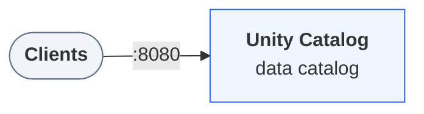
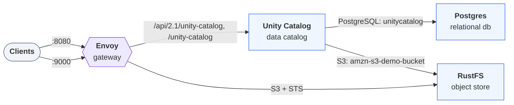

Every example in these docs runs against a local [Unity Catalog](https://unitycatalog.io/docs/explanation/what-is-unity-catalog/ "The open-source reference server implementing the Unity Catalog specification.") server that you start with Docker Compose. The docs ship several environments, each with its own download. Each runs the same single-user server on `http://localhost:8080`, potentially with additional services like PostgreSQL or S3 enabled.

> **Tip**
>
> These environments are deliberately small. For more complex setups around a Unity Catalog server, see the [Unity Catalog Playground](https://github.com/open-lakehouse/unitycatalog-playground) repository.

> **Prerequisites**
>
> - [Docker](https://docs.docker.com/get-started/get-docker/) with Compose v2, for the local environment.

## Choose an environment

| Environment                                                     | Use it for                                                                                                                       | Host ports |
| --------------------------------------------------------------- | -------------------------------------------------------------------------------------------------------------------------------- | ---------- |
| [Minimal server](#start-the-minimal-server)                     | Most pages: catalogs, schemas, tables, volumes, functions, and engines on local files                                            | 8080       |
| [Server with simulated S3](#start-the-server-with-simulated-s3) | S3 storage, storage credentials, credential vending, and metadata in PostgreSQL that survives a new or upgraded server container | 8080, 9000 |

Every page's prerequisites name the environment it runs against. Run one environment at a time: they share the compose project `uc-docs` and the container name `unitycatalog`, so starting one replaces the server of another.

The commands below download each environment into `uc-docs-env/` in the current folder, and the server mounts its configuration from there. On Colima and other VMs that share only your home directory, run them from a folder under your home directory, or the server fails with a `not a directory` mount error.

## Start the minimal server

```bash
curl -fsSL https://unitycatalog.io/docs/env/unitycatalog.tar.gz | tar -xz
cd uc-docs-env/unitycatalog && docker compose up -d --wait
export UNITY_CATALOG_URL=http://localhost:8080/api/2.1/unity-catalog
```

The services Unity Catalog 0.7.0 runs and how clients reach them



> **What it runs**
>
> - The `unitycatalog` server, with authorization disabled, on `http://localhost:8080`.
> - The REST API at `http://localhost:8080/api/2.1/unity-catalog`, and the Iceberg REST catalog under `/iceberg` on the same path.
> - The sample catalog `unity`, so there is something to browse right away.
> - Metadata in an H2 file inside the container, discarded when you stop it.
> - [`UC_DOCS_ROOT`](#share-a-folder-with-the-server), default `/tmp/uc-docs`, mounted at the same path, for tables and volume files on local storage.

`docker compose up --wait` returns once the server reports healthy. The server builds from the upstream release image, with two fixes for running on Linux.

Both environments are generated by [Trestle](https://github.com/open-lakehouse/trestle): `compose.yaml` includes one file per service under `modules/`, and `LAYOUT.md` lists the routes and services. The server's part:

`modules/unity-catalog/compose.yaml`

```yaml
# Unity Catalog
services:
  unitycatalog:
    container_name: unitycatalog
    # Built locally from the render root, tagged with the `image` knob.
    build:
      context: ./image
    pull_policy: build
    image: uc-docs-unitycatalog:0.7.0
    # The server ignores SIGTERM as PID 1.
    init: true
    restart: unless-stopped
    depends_on:
      unitycatalog-mounts:
        condition: service_completed_successfully
    secrets:
      - source: unitycatalog_server_properties
        target: /home/unitycatalog/etc/conf/server.properties
    volumes:
      - ${UC_DOCS_ROOT:-/tmp/uc-docs}:${UC_DOCS_ROOT:-/tmp/uc-docs}
    expose:
      - "8080"
    ports:
      - "8080:8080"
    healthcheck:
      test:
        ["CMD-SHELL", "wget -q --spider http://127.0.0.1:8080/api/2.1/unity-catalog/catalogs || exit 1"]
      interval: 10s
      timeout: 5s
      retries: 12
      start_period: 15s

  # One-shot: Docker creates a missing bind source owned by root, so open the paths up for
  # the server and for host-side clients that write to the same directories.
  unitycatalog-mounts:
    image: python:3.13-alpine
    user: root
    restart: "no"
    entrypoint:
      - chmod
      - "0777"
      - "${UC_DOCS_ROOT:-/tmp/uc-docs}"
    volumes:
      - ${UC_DOCS_ROOT:-/tmp/uc-docs}:${UC_DOCS_ROOT:-/tmp/uc-docs}
```

`modules/unity-catalog/secrets/server.properties`

```properties
# Generated by trestle. A local, single-user server: authorization is disabled, so never use
# this configuration for a shared server.
server.env=dev
server.authorization=disable
```

## Start the server with simulated S3

```bash
curl -fsSL https://unitycatalog.io/docs/env/uc-aws.tar.gz | tar -xz
cd uc-docs-env/uc-aws && docker compose up -d --wait
export AWS_ALLOW_HTTP=true
export AWS_ENDPOINT_URL=http://localhost:9000
export AWS_ENDPOINT_URL_S3=http://localhost:9000
export AWS_REGION=us-east-1
export UNITY_CATALOG_URL=http://localhost:8080/api/2.1/unity-catalog
```

The services Unity Catalog 0.7.0 with simulated S3 and PostgreSQL runs and how clients reach them



> **What it runs**
>
> - The server, configured with an AWS master role, behind an Envoy gateway on `http://localhost:8080`.
> - A local S3 and STS ([RustFS](https://rustfs.com) and a small STS shim) that the gateway answers on the real AWS hostnames, so the server runs its real AWS code path.
> - An S3 bucket named `amzn-s3-demo-bucket`, reachable from your machine at `http://localhost:9000`.
> - Metadata in a `db` PostgreSQL service (database `unitycatalog`), reachable only from the server. Its data lives in the `postgres-data` volume, so catalogs survive stopping, recreating, or upgrading the server container. It starts empty: the sample catalog `unity` isn't there.
> - The `export` lines point clients in the current terminal at the stack. Run them again in each terminal you run examples from.

The simulated STS enforces the session policy that the server attaches to the credentials it vends. It doesn't check IAM trust policies or external IDs, so verify those on real AWS.

The server's part, with its AWS master role and the gateway's certificates:

`modules/unity-catalog/compose.yaml`

```yaml
# Unity Catalog
services:
  unitycatalog:
    container_name: unitycatalog
    # Built locally from the render root, tagged with the `image` knob.
    build:
      context: ./image
    pull_policy: build
    image: uc-docs-unitycatalog:0.7.0
    # The server ignores SIGTERM as PID 1.
    init: true
    restart: unless-stopped
    depends_on:
      db:
        condition: service_healthy
      rustfs-init:
        condition: service_completed_successfully
      gateway-certs:
        condition: service_completed_successfully
      unitycatalog-mounts:
        condition: service_completed_successfully
    secrets:
      - source: unitycatalog_server_properties
        target: /home/unitycatalog/etc/conf/server.properties
      # Points the metadata store at the relational_db provider instead of the built-in H2.
      - source: unitycatalog_hibernate_properties
        target: /home/unitycatalog/etc/conf/hibernate.properties
    environment:
      # Trust the gateway's local CA, which answers the AWS STS/S3 hostnames UC calls.
      JAVA_TOOL_OPTIONS: -Djavax.net.ssl.trustStore=/certs/truststore.p12 -Djavax.net.ssl.trustStorePassword=changeit
    volumes:
      - gateway-certs:/certs:ro
      - ${UC_DOCS_ROOT:-/tmp/uc-docs}:${UC_DOCS_ROOT:-/tmp/uc-docs}
    expose:
      - "8080"
    healthcheck:
      test:
        ["CMD-SHELL", "wget -q --spider http://127.0.0.1:8080/api/2.1/unity-catalog/catalogs || exit 1"]
      interval: 10s
      timeout: 5s
      retries: 12
      start_period: 15s

  # One-shot: Docker creates a missing bind source owned by root, so open the paths up for
  # the server and for host-side clients that write to the same directories.
  unitycatalog-mounts:
    image: python:3.13-alpine
    user: root
    restart: "no"
    entrypoint:
      - chmod
      - "0777"
      - "${UC_DOCS_ROOT:-/tmp/uc-docs}"
    volumes:
      - ${UC_DOCS_ROOT:-/tmp/uc-docs}:${UC_DOCS_ROOT:-/tmp/uc-docs}
```

`modules/unity-catalog/secrets/server.properties`

```properties
# Generated by trestle. A local, single-user server: authorization is disabled, so never use
# this configuration for a shared server.
server.env=dev
server.authorization=disable

# The master identity UC signs AWS calls with: it assumes a storage credential's role to vend
# temporary credentials. The storage itself (credentials, external locations) is registered in
# UC's database, not here. No endpoint override, which UC doesn't support.
aws.accessKey=rustfs-root
aws.secretKey=rustfs-root-secret
aws.region=us-east-1
aws.masterRoleArn=arn:aws:iam::123456789012:role/uc-master
```

Pages that use this environment:

- [Configure AWS storage credentials and external locations](https://unitycatalog.io/docs/how-to/configure-aws-storage/)
- [Set managed storage for catalogs and schemas on S3](https://unitycatalog.io/docs/how-to/managed-storage-s3/)
- [Use Iceberg REST clients with Unity Catalog](https://unitycatalog.io/docs/how-to/iceberg-rest/)

## Share a folder with the server

The server container mounts one directory, `UC_DOCS_ROOT` (default `/tmp/uc-docs`), at the same path as on your machine. A `file://` location under it then means the same files to the server and to your client. Pages that write tables or volume files on local storage use it.

Docker Desktop shares `/tmp` with containers by default. Colima and some other VMs share only your home directory. On those, pick a folder under your home directory and set it before you start the server, in every terminal you use:

```bash
export UC_DOCS_ROOT=$HOME/uc-docs
mkdir -p "$UC_DOCS_ROOT"
docker compose up -d --wait
```

## Run the `uc` CLI

The `uc` command-line tool ships inside the server image. Define a shell function that runs it in the container, from any folder:

`first_catalog.sh`

```bash
uc() { docker exec unitycatalog bin/uc "$@"; }
```

Then `uc catalog list` lists the catalogs. The CLI connects to `http://localhost:8080` by default.

## Stop or reset the server

Stop an environment from the folder you started it in, `uc-docs-env/unitycatalog` or `uc-docs-env/uc-aws`, so that its other services stop too:

```bash
docker compose down
```

The minimal server keeps its metadata in the container, so stopping it discards every catalog you created and restores the samples. The S3 environment keeps its metadata and bucket in Docker volumes; add `-v` to its `down` command to delete those as well. Files you wrote under `UC_DOCS_ROOT` stay on your machine.

> **Warning**
>
> These environments have authorization disabled: anyone who can reach port 8080 can read and change everything in the catalog. Use them only on your own machine.

## Next steps

- [Create your first catalog](https://unitycatalog.io/docs/tutorials/getting-started/) uses the minimal server from the command line.
- [Use the Python client](https://unitycatalog.io/docs/tutorials/python-client/), [Spark](https://unitycatalog.io/docs/how-to/configure-spark/), or [DuckDB](https://unitycatalog.io/docs/how-to/duckdb/) to connect to it.
