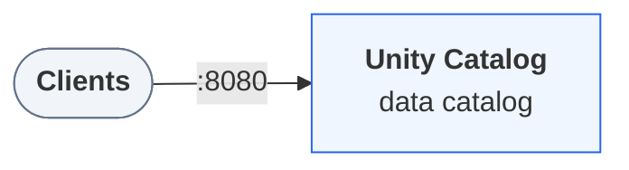

## Companion files

CI-tested scripts that run this page's examples end to end. A script that exits 0 has passed its checks.

They need Unity Catalog 0.7.0 running. To start it (also `environment` in this file's frontmatter):

```bash
curl -fsSL https://unitycatalog.io/docs/env/unitycatalog.tar.gz | tar -xz
cd uc-docs-env/unitycatalog && docker compose up -d --wait
export UNITY_CATALOG_URL=http://localhost:8080/api/2.1/unity-catalog
```

- [`asyncio_py314.py`](https://unitycatalog.io/docs/tutorials/first-python-function/snippets/asyncio_py314.py) (Python): On Python 3.14, asyncio.run fails at exit once unitycatalog-ai's client is imported.
  - run: `uv run https://unitycatalog.io/docs/tutorials/first-python-function/snippets/asyncio_py314.py`
- [`first_function.py`](https://unitycatalog.io/docs/tutorials/first-python-function/snippets/first_function.py) (Python): Register a Python function in Unity Catalog, inspect it, run it, and remove it.
  - run: `UNITY_CATALOG_URL=http://localhost:8080/api/2.1/unity-catalog uv run first_function.py`
  - save [`pricing.py`](https://unitycatalog.io/docs/tutorials/first-python-function/snippets/pricing.py) beside it first; the script imports it

In this tutorial you turn an ordinary Python function into a catalog object. You register it under a three-part name, see what Unity Catalog stores about it, call it by that name, and remove it again. Once a function is in the catalog, applications and AI agents with access can find and call it by name, without copying your code.

> **Prerequisites**
>
> - [Docker](https://docs.docker.com/get-started/get-docker/) with Compose v2, for the local environment.
> - [uv](https://docs.astral.sh/uv/getting-started/installation/).

## Step 1 — Start the environment

Download the docs' environment and start Unity Catalog 0.7.0. Already running it? Skip this.

```bash
curl -fsSL https://unitycatalog.io/docs/env/unitycatalog.tar.gz | tar -xz
cd uc-docs-env/unitycatalog && docker compose up -d --wait
export UNITY_CATALOG_URL=http://localhost:8080/api/2.1/unity-catalog
```

The services Unity Catalog 0.7.0 runs and how clients reach them



Stop it later with `docker compose down` from `uc-docs-env/unitycatalog`.

## Step 2 — Open a Python session

Create an empty folder and, in it, open a Python session with `unitycatalog-ai`, the client library for catalog functions:

```bash
mkdir first-function && cd first-function
EXECUTOR_MAX_MEMORY_LIMIT=4096 uv run --python 3.12 --with unitycatalog-ai==0.4.0 python -m asyncio
```

Use Python 3.12, the version this page's scripts run on. Enter each of the following snippets in the session, in order.

> **Note**
>
> `python -m asyncio` is a Python shell that accepts `await` at the top level, which the asynchronous client needs.

> **Note**
>
> The function sandbox caps each call's virtual memory at `EXECUTOR_MAX_MEMORY_LIMIT` megabytes (100 by default), a limit that applies only on Linux. The command above sets it to 4096, the value this tutorial's script runs with.

## Step 3 — Connect to the server

`first_function.py`

```python
from unitycatalog.ai.core.client import (
    UnitycatalogClient,
    UnitycatalogFunctionClient,
)
from unitycatalog.client import ApiClient, CatalogsApi, Configuration

config = Configuration(host="http://localhost:8080/api/2.1/unity-catalog")
api = ApiClient(config)
client = UnitycatalogFunctionClient(api_client=api)
```

## Step 4 — Create a schema for functions

Functions live in a schema like tables do. Create a catalog and a schema for them:

`first_function.py`

```python
uc = UnitycatalogClient(api_client=api)
await uc.create_catalog_async(
    name="tools", comment="Functions for apps and agents"
)
await uc.create_schema_async(name="pricing", catalog_name="tools")
```

## Step 5 — Write the function

Save the function you are going to register as `pricing.py`, in the folder where the session runs:

`pricing.py`

```python
def order_total(quantity: int, unit_price: float, discount_pct: float = 0.0) -> float:
    """
    Calculate the total price of an order line after a percentage discount.

    Args:
        quantity: Number of units ordered.
        unit_price: Price of one unit.
        discount_pct: Discount in percent, from 0 to 100.

    Returns:
        The discounted total, rounded to two decimals.
    """
    return round(quantity * unit_price * (1 - discount_pct / 100), 2)
```

Then import it into the session:

`first_function.py`

```python
from pricing import order_total
```

The client reads the function's source code to register it, so define functions in a module like this one rather than typing them into the session.

> **Tip**
>
> Every argument and the return value need a type hint, because the catalog stores the function's signature as SQL types: `int` becomes `LONG`, and `float` becomes `DOUBLE`. The docstring follows the Google style. The client stores its first paragraph as the function's comment and each `Args:` entry as that parameter's comment. An AI agent later reads exactly these descriptions to decide when to call the function, so they are worth writing well.

## Step 6 — Register the function

Hand the imported function to the client:

`first_function.py`

```python
info = await client.create_python_function_async(
    func=order_total,
    catalog="tools",
    schema="pricing",
)
print(info.full_name)  # tools.pricing.order_total
```

The client reads the signature and docstring, then stores everything as `tools.pricing.order_total`. Before it creates the function, it checks whether the name is taken. The log line `Failed to retrieve function
tools.pricing.order_total ... (404)` that appears is that check, and you can ignore it.

## Step 7 — See what the catalog stored

Fetch the function back from the catalog:

`first_function.py`

```python
fn = await client.get_function_async("tools.pricing.order_total")
print(fn.comment)
for param in fn.input_params.parameters:
    print(f"{param.name}: {param.type_text} - {param.comment}")
print("returns:", fn.full_data_type)
print(fn.routine_definition)
```

The output shows the comment, three typed parameters with their descriptions, `returns: DOUBLE`, and the function body:

```text
return round(quantity * unit_price * (1 - discount_pct / 100), 2)
```

That body is the important part. The catalog stores your code as text, together with the metadata needed to call it. It doesn't run the code.

## Step 8 — Run the function by name

Execute the function through the catalog:

`first_function.py`

```python
result = await client.execute_function_async(
    "tools.pricing.order_total",
    parameters={"quantity": 3, "unit_price": 19.99, "discount_pct": 10.0},
)
print(result.value)  # 53.97
```

Leave out `discount_pct` and its default of `0.0` applies, because the catalog stored the default too:

`first_function.py`

```python
result = await client.execute_function_async(
    "tools.pricing.order_total",
    parameters={"quantity": 3, "unit_price": 19.99},
)
print(result.value)  # 59.97
```

The first call returns `53.97`, and the second `59.97`.

> **Note**
>
> Neither call ran on the server. The client fetched the stored definition, rebuilt the function from it, and ran it on your machine, in a separate Python process by default. So whoever calls a catalog function runs it with their own Python environment and permissions. To run in the calling process instead, pass `execution_mode="local"` to `UnitycatalogFunctionClient`.

## Step 9 — Pass the right types

The client checks every argument against the stored parameter types before it runs anything. `20` is an `int`, but `unit_price` is a `DOUBLE`:

`first_function.py`

```python
try:
    await client.execute_function_async(
        "tools.pricing.order_total",
        parameters={"quantity": 3, "unit_price": 20},
    )
except ValueError as exc:
    print(exc)  # ... unit_price should be of type ... DOUBLE ...
```

The call raises `ValueError` and doesn't run the function. Pass `20.0` instead.

## Step 10 — List and clean up

List the functions in the schema, then remove the function and the catalog:

`first_function.py`

```python
functions = await client.list_functions_async(catalog="tools", schema="pricing")
print([f.full_name for f in functions])
```

`first_function.py`

```python
await client.delete_function_async("tools.pricing.order_total")
await CatalogsApi(api).delete_catalog(name="tools", force=True)
await api.close()
```

To register the function again under the same name, pass `replace=True` to `create_python_function_async`; without it, registration fails with `Function tools.pricing.order_total already exists`. Leave the session with `Ctrl+D`.

## What you did

You registered a Python function under a catalog name. Unity Catalog stored its signature, descriptions, default, and source code, and the client used that record to validate arguments and run the function on your side. Catalog functions work this way in general: the catalog makes them discoverable and governed, and the caller runs them.

## Next steps

- [Core concepts](https://unitycatalog.io/docs/explanation/uc-basics/) explains where functions sit among the other catalog objects, and the `EXECUTE` privilege that controls who can call them.
