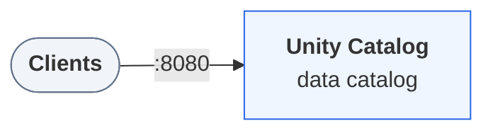

## Companion files

CI-tested scripts that run this page's examples end to end. A script that exits 0 has passed its checks.

They need Unity Catalog 0.7.0 running. To start it (also `environment` in this file's frontmatter):

```bash
curl -fsSL https://unitycatalog.io/docs/env/unitycatalog.tar.gz | tar -xz
cd uc-docs-env/unitycatalog && docker compose up -d --wait
export UNITY_CATALOG_URL=http://localhost:8080/api/2.1/unity-catalog
```

- [`first_catalog.sh`](https://unitycatalog.io/docs/tutorials/getting-started/snippets/first_catalog.sh) (Shell): Create a catalog, schema, and table with the uc CLI, write and read rows, then clean up.
  - run: `bash first_catalog.sh` from `uc-docs-env/unitycatalog`

In this tutorial you start a Unity Catalog server on your machine, look around the sample data it ships with, and then build your own corner of the catalog: a catalog, a schema inside it, and a Delta table you write to and read back.

> **Prerequisites**
>
> - [Docker](https://docs.docker.com/get-started/get-docker/) with Compose v2, for the local environment.

## Step 1 — Start the server

Download the docs' environment and start Unity Catalog 0.7.0. Already running it? Skip this.

```bash
curl -fsSL https://unitycatalog.io/docs/env/unitycatalog.tar.gz | tar -xz
cd uc-docs-env/unitycatalog && docker compose up -d --wait
export UNITY_CATALOG_URL=http://localhost:8080/api/2.1/unity-catalog
```

The services Unity Catalog 0.7.0 runs and how clients reach them



Stop it later with `docker compose down` from `uc-docs-env/unitycatalog`.

The server now listens on `http://localhost:8080`. Authorization is off, so every command succeeds without a token. That keeps this tutorial short, and it is also why this configuration must never serve anyone but you. [Run a local Unity Catalog server](https://unitycatalog.io/docs/how-to/run-local-server/) describes the environment.

## Step 2 — Define a shortcut for the CLI

The CLI lives inside the server's container. Define this shortcut in every terminal you use:

`first_catalog.sh`

```bash
uc() { docker exec unitycatalog bin/uc "$@"; }
```

## Step 3 — Browse the sample data

The server comes with two sample catalogs. List them, then look one level down at a time, through a schema to its tables:

`first_catalog.sh`

```bash
uc catalog list --output jsonPretty
uc schema list --catalog unity --output jsonPretty
uc table list --catalog unity --schema default --output jsonPretty
```

You see the sample catalog `unity`. Its schema `default` holds tables such as `numbers` and `marksheet`. Every table has a three-part name, `catalog.schema.table`.

Read a few rows from one of them:

`first_catalog.sh`

```bash
uc table read --full_name unity.default.numbers --max_results 5
```

The output is a table with the columns `as_int` and `as_double`. The CLI asked the catalog where `unity.default.numbers` lives, then read the Delta files at that location.

## Step 4 — Create a catalog

Now make your own. A catalog is the top level of the namespace:

`first_catalog.sh`

```bash
uc catalog create --name quickstart --comment "My first catalog"
```

The CLI prints the new catalog, including its generated `ID`. Run `uc catalog list` again and `quickstart` is now listed next to the samples.

## Step 5 — Create a schema

A schema groups related tables, and always belongs to one catalog:

`first_catalog.sh`

```bash
uc schema create --catalog quickstart --name sales --comment "Order data"
```

Its full name is `quickstart.sales`.

## Step 6 — Create a table

Create a Delta table with three columns. `--storage_location` tells the catalog where the table's files live:

`first_catalog.sh`

```bash
uc table create --full_name quickstart.sales.orders \
  --columns "order_id INT, customer STRING, amount DOUBLE" \
  --format DELTA \
  --storage_location file:///tmp/uc/orders
```

This is an *external* table: you chose the location, and the catalog records it alongside the table's name and columns. The path is inside the container, so the files go away when you remove the container.

## Step 7 — Write and read rows

Fill the table with sample rows, then read them back by name:

`first_catalog.sh`

```bash
uc table write --full_name quickstart.sales.orders
```

`first_catalog.sh`

```bash
uc table read --full_name quickstart.sales.orders --max_results 5
```

You see rows with `order_id`, `customer`, and `amount` columns.

> **Note**
>
> `uc table write` exists for trying things out: it writes randomly generated rows that match the table's columns, so your values differ from anyone else's. Real applications write through an engine such as Spark or a Delta library.

## Step 8 — Clean up

Delete your catalog together with everything in it:

`first_catalog.sh`

```bash
uc catalog delete --name quickstart --force true
```

Leave the server running for the next tutorial. When you're done, [stop it](https://unitycatalog.io/docs/how-to/run-local-server/#stop-or-reset-the-server) with `docker compose down`. The server keeps its metadata inside the container, so stopping it also resets the sample catalogs.

## What you did

You ran a Unity Catalog server and used it the way every client does. You found data by its three-part name, and the catalog answered with metadata and a storage location. Then you registered a catalog, schema, and table of your own.

## Next steps

- [Core concepts](https://unitycatalog.io/docs/explanation/uc-basics/) explains the objects you just created and how they relate.
- [Use the Python client](https://unitycatalog.io/docs/tutorials/python-client/) does the same from Python.
- [Manage catalogs and schemas](https://unitycatalog.io/docs/how-to/manage-catalogs-and-schemas/) covers updating, renaming, and deleting them.
