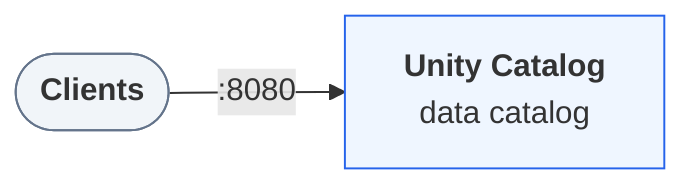

## Companion files

CI-tested scripts that run this page's examples end to end. A script that exits 0 has passed its checks.

They need Unity Catalog 0.7.0 running. To start it (also `environment` in this file's frontmatter):

```bash
curl -fsSL https://unitycatalog.io/docs/env/unitycatalog.tar.gz | tar -xz
cd uc-docs-env/unitycatalog && docker compose up -d --wait
export UNITY_CATALOG_URL=http://localhost:8080/api/2.1/unity-catalog
```

- [`catalog_flow.py`](https://unitycatalog.io/docs/tutorials/python-client/snippets/catalog_flow.py) (Python): Create a catalog, schema, and table with the Unity Catalog Python client.
  - run: `UNITY_CATALOG_URL=http://localhost:8080/api/2.1/unity-catalog uv run https://unitycatalog.io/docs/tutorials/python-client/snippets/catalog_flow.py`

In this tutorial you build the same small catalog as in [Create your first catalog](https://unitycatalog.io/docs/tutorials/getting-started/), this time from Python with [`unitycatalog-client`](https://pypi.org/project/unitycatalog-client/), the official SDK for the [Unity Catalog](https://unitycatalog.io/docs/explanation/what-is-unity-catalog/ "The open-source reference server implementing the Unity Catalog specification.") REST API. You connect, create a catalog, a schema, and a table, see how the client reports an object that doesn't exist, and clean up. Applications, notebooks, and scripts use the same calls to manage catalog objects.

> **Prerequisites**
>
> - [Docker](https://docs.docker.com/get-started/get-docker/) with Compose v2, for the local environment.
> - [uv](https://docs.astral.sh/uv/getting-started/installation/).

## Step 1 — Start the environment

Download the docs' environment and start Unity Catalog 0.7.0. Already running it? Skip this.

```bash
curl -fsSL https://unitycatalog.io/docs/env/unitycatalog.tar.gz | tar -xz
cd uc-docs-env/unitycatalog && docker compose up -d --wait
export UNITY_CATALOG_URL=http://localhost:8080/api/2.1/unity-catalog
```

The services Unity Catalog 0.7.0 runs and how clients reach them



Stop it later with `docker compose down` from `uc-docs-env/unitycatalog`.

## Step 2 — Open a Python session

Open a Python session with the client installed:

```bash
uv run --with unitycatalog-client==0.7.0 python -m asyncio
```

Enter each of the following snippets in it, in order.

> **Note**
>
> `python -m asyncio` is a Python shell that accepts `await` at the top level, which the asynchronous client needs.

## Step 3 — Connect to the server

Point a `Configuration` at the server and open an `ApiClient`. Each resource type has its own API class built on that client:

`catalog_flow.py`

```python
from unitycatalog.client import (
    ApiClient,
    CatalogsApi,
    Configuration,
    SchemasApi,
    TablesApi,
)

config = Configuration(host="http://localhost:8080/api/2.1/unity-catalog")
api = ApiClient(config)
catalogs = CatalogsApi(api)
schemas = SchemasApi(api)
tables = TablesApi(api)
```

The host includes the API prefix, `/api/2.1/unity-catalog`. Authorization is off on the local server, so the client needs no token.

## Step 4 — Create a catalog

Every create call takes one request object:

`catalog_flow.py`

```python
from unitycatalog.client import CreateCatalog

catalog = await catalogs.create_catalog(
    CreateCatalog(name="quickstart", comment="Created from Python")
)
print(catalog.name, catalog.id)
```

The server returns the new catalog, including the `id` it generated.

## Step 5 — List catalogs

A list call returns a response object. Its `catalogs` field holds the items:

`catalog_flow.py`

```python
listed = await catalogs.list_catalogs()
print([c.name for c in listed.catalogs])
```

`quickstart` is listed next to the sample catalog `unity`.

## Step 6 — Create a schema

A schema lives inside one catalog:

`catalog_flow.py`

```python
from unitycatalog.client import CreateSchema

schema = await schemas.create_schema(
    CreateSchema(name="sales", catalog_name="quickstart")
)
print(schema.full_name)  # quickstart.sales
```

## Step 7 — Create a table

Register an external Delta table with one column in the new schema:

`catalog_flow.py`

```python
from unitycatalog.client import CreateTable
from unitycatalog.client.models import (
    ColumnInfo,
    ColumnTypeName,
    DataSourceFormat,
    TableType,
)

table = await tables.create_table(
    CreateTable(
        name="orders",
        catalog_name="quickstart",
        schema_name="sales",
        table_type=TableType.EXTERNAL,
        data_source_format=DataSourceFormat.DELTA,
        storage_location="file:///tmp/uc-docs/quickstart/orders",
        columns=[
            ColumnInfo(
                name="order_id",
                type_name=ColumnTypeName.LONG,
                type_text="bigint",
                type_json='{"name":"order_id","type":"long","nullable":false,"metadata":{}}',
                position=0,
                nullable=False,
            )
        ],
    )
)
print(table.catalog_name, table.schema_name, table.name, table.table_type)
```

Each column carries its type three ways: a `type_name` enum, a SQL `type_text`, and `type_json`, the column in Delta schema form. Registering a table stores only metadata, so the location doesn't need to exist yet. [Register an existing external table](https://unitycatalog.io/docs/how-to/register-external-table/) shows how to read these values from a real Delta table.

## Step 8 — Handle a missing object

Asking for an object that doesn't exist raises a typed exception that carries the HTTP status:

`catalog_flow.py`

```python
from unitycatalog.client.exceptions import NotFoundException

try:
    await tables.get_table(full_name="quickstart.sales.returns")
except NotFoundException as exc:
    print("not found:", exc.status)  # not found: 404
```

Other error responses raise sibling exceptions such as `BadRequestException` and `UnauthorizedException`, all subclasses of `ApiException`.

## Step 9 — Clean up

Delete from the inside out, the table before its schema and the schema before its catalog:

`catalog_flow.py`

```python
await tables.delete_table(full_name="quickstart.sales.orders")
await schemas.delete_schema(full_name="quickstart.sales")
await catalogs.delete_catalog(name="quickstart")
await api.close()
```

The server refuses to delete a catalog or schema that still holds objects, unless you pass `force=True`. Leave the session with `Ctrl+D`.

## What you did

You managed catalog objects from Python with the same requests the `uc` CLI sends. Every client, from this SDK to Spark, talks to the same REST API and sees the same names.

## Next steps

- [Manage catalogs and schemas](https://unitycatalog.io/docs/how-to/manage-catalogs-and-schemas/) covers updating, renaming, and deleting them from Python or the CLI.
- [Create and update a catalog-managed Delta table](https://unitycatalog.io/docs/tutorials/managed-delta-table/) writes real data into a table that Unity Catalog manages.
