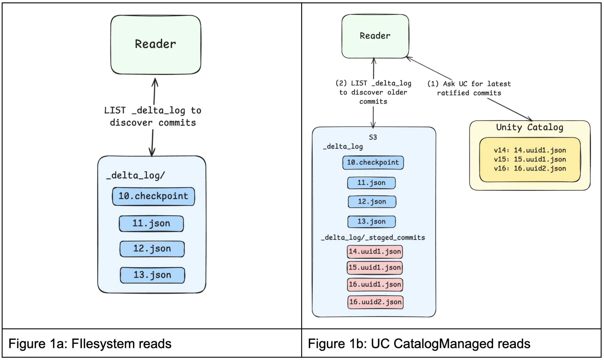
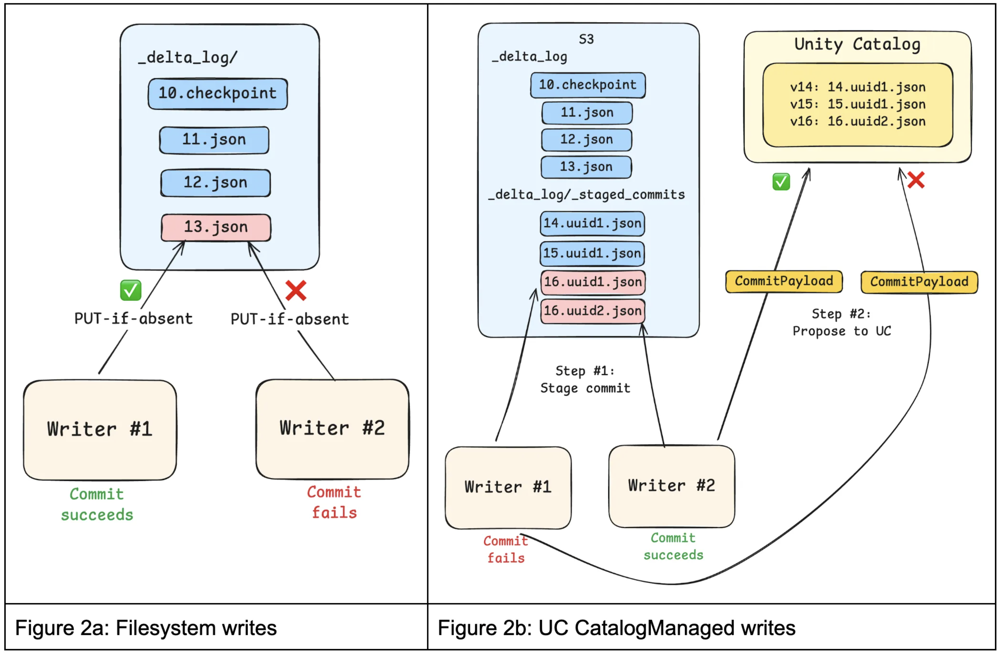
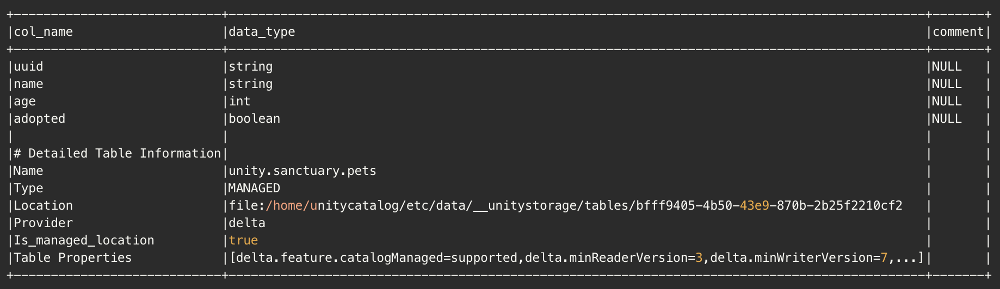

Filesystem-based coordination limits the ability of open table formats to meet modern data teams’ demands for governance and performance. When tables are accessed directly via filesystem paths, access control becomes fragmented, schema changes can slip through unchecked, and metadata resolution can introduce avoidable latency.

In response, open table formats such as [Delta](https://docs.delta.io/delta-catalog-managed-tables/) and [Iceberg](https://iceberg.apache.org/terms/#catalog) have evolved toward a catalog-centric architecture, making the catalog the authoritative source of governance, discoverability, and table state. Building on this evolution, [Unity Catalog 0.4.0](https://github.com/unitycatalog/unitycatalog/releases/tag/v0.4.0) introduces [UC managed tables](https://github.com/unitycatalog/unitycatalog/blob/main/spec/protocols/ManagedDeltaTablesSpec.md), which deliver centralized governance, streamlined discovery, and more performant queries for [catalog-managed Delta tables](https://github.com/delta-io/delta/blob/master/PROTOCOL.md#catalog-managed-tables).

## Challenges with filesystem-managed Delta tables

With features such as Liquid Clustering in OSS Spark and Predictive Optimization, tables are increasingly optimized for efficient data layout and selective query performance. In these well-organized (yet potentially large) tables for selective queries, we can often aggressively filter down the files needed to resolve a user query. As a result, the bottleneck in query execution can shift from query resolution to resolving the current table state.

To access filesystem-managed Delta tables, Delta clients first look at the transaction log (\_delta_log) stored with the table to determine the latest version. Clients then reconstruct the current state of the table by replaying the log entries, which describe the table’s schema and the data files associated with it. Once the table state is known, the system reads the relevant data files to answer the query.

Going beyond performance, when relying on the file system to validate a commit, we cannot impose constraints on the kinds of changes allowed for a given table. When writing to the table, clients write new data files to storage and then atomically commit a new transaction log entry via filesystem APIs to advance the table to a new version. This makes committing to a table a binary decision — success or failure — but we lack the ability to consider the type of change a writer is trying to write.

Many (if not all) seasoned data engineers can share stories of pipelines breaking (usually at the least convenient time) due to upstream tables changing their schemas or other unexpected changes to table metadata.

In short, relying on the filesystem to coordinate access can lead to

1. **Bottlenecked performance**: Replaying the Delta transaction log to resolve a table’s latest state requires multiple calls to the filesystem, which can add 100+ ms to query execution and even become the dominant factor for query execution time.
2. **Unsafe schema changes**: Path-based writes can modify table schemas or metadata without validation, potentially introducing incompatible changes that break downstream workloads. This occurs because storage credentials cannot distinguish between clients authorized to write data and those authorized to modify table metadata.
3. **Poor auditability**: Filesystem-managed Delta tables rely on storage-level access controls, so auditing often requires piecing together raw object storage logs. These logs operate at the file level rather than the table level, making it difficult to understand who accessed a given dataset or to review permissions in a meaningful way.

These challenges can lead to production downtime and governance gaps. Making Unity Catalog the native coordination layer for table access and the authoritative source of table state addresses these issues by providing a unified governance model, enforcing constraints reliably, and improving performance.

## How UC managed tables address these challenges

Having a central authority to coordinate commits for all writers to a table allows for several optimizations that reduce load on the data platform and improve robustness. Before going deeper, let’s examine roughly how UC managed commits work.

The files stored on disk still serve as a durable source for table data and metadata. However, the catalog may internally track several in-flight commits, which are asynchronously flushed to storage. When a client reads a table via the catalog, it receives the current table schema and metadata, along with all in-flight commits. Only the remaining commits are read from the file system. This completely eliminates the need for file system access prior to physical query planning.

On the write path, clients still materialize all data files prior to attempting a commit; however, only the catalog can advance the version and update the delta log. This allows the catalog to semantically validate a commit and potentially reject it based on in-principle arbitrary policies — let’s say only allowing schema evolution on a Friday afternoon.

All in all, with UC managed tables, we get

1. **Faster query planning and faster writes**: If a Delta client is trying to access a table, Unity Catalog can directly inform it of the table-level metadata. This skips cloud storage entirely and removes a major source of metadata latency.
2. **Enforceable constraints**: Unity Catalog can authoritatively validate or reject schema and constraint changes, preventing incompatible updates that could compromise data integrity or break downstream workloads.
3. **Holistic auditability**: Unity Catalog centralizes table metadata and access policies, allowing teams to inspect permissions and table ownership through a consistent catalog interface rather than relying solely on low-level storage logs.

Unity Catalog managed tables dramatically simplify how engines discover and access data under consistent governance, all while improving read and write performance.

## How do UC managed tables work?

The [Catalog-Managed Tables](https://docs.delta.io/delta-catalog-managed-tables/) Delta feature fundamentally changes how Delta tables are discovered, read, and written to.

### Table Discovery

UC managed tables are discovered and accessed through Unity Catalog, not by filesystem paths. Engines must first resolve a table by name through Unity Catalog, establishing table identity, location, and access credentials. This resolution step occurs before the Delta client interacts with the filesystem and determines the rules the client must follow for subsequent reads and writes.

### Reads

A UC managed table may have commits that have been ratified by Unity Catalog but not yet flushed, or “published”, to the filesystem. Reads therefore begin by getting these latest commits from Unity Catalog via the GET Commits API.

If additional history is required, such as older published commits or checkpoints, Delta clients can LIST the filesystem and merge those published commits with the commits provided by Unity Catalog to construct a complete snapshot. This split view allows Unity Catalog to always provide the most recent table state while offloading long-term commit storage to the filesystem.



### **Writes**

Previously, writing to a Delta table involved calling filesystem “PUT-if-absent” APIs to perform atomic writes with mutual exclusion. In this model, the filesystem determined which writes win. While simple and scalable, this approach treated commits as opaque blobs: the filesystem could not inspect commit contents, enforce constraints, or coordinate writes across tables.

For UC managed tables, clients propose commits to Unity Catalog, typically by first staging commits in the filesystem’s \<table_path\>/\_delta_log/\_staged_commits directory and then requesting ratification. Staging ensures that readers never observe unapproved commits. The protocol also allows for “inline” commits, where the contents of the commit are sent directly to Unity Catalog, skipping the 100ms+ filesystem write. Staged commits are still performed using optimistic concurrency control to provide transactional guarantees.

To unburden Unity Catalog from having to store these ratified commits indefinitely, ratified commits can be periodically “published” to the \_delta_log in the filesystem. Once published, Unity Catalog no longer needs to retain or serve those commits because clients can easily discover them by listing.



## What capabilities do UC managed tables unlock for data teams?

Since all reads and writes to UC managed tables are brokered by Unity Catalog, data teams have the foundations to implement capabilities including:

- **Multi-table transactions**: Engines can coordinate atomic updates across multiple tables with Unity Catalog
- **Automated table optimizations**: Unity Catalog has visibility into all table accesses, which systems can leverage to optimize data layout for better performance
- **Fine-grained access control**: Unity Catalog evaluates the principal and requested operation, enabling engines to enforce fine-grained (e.g. row-level, column-level) policies accordingly

## Getting started with UC managed tables

To get started with UC managed tables, you’ll need both [Delta Lake 4.1.0](https://github.com/delta-io/delta/releases/tag/v4.1.0) and [Unity Catalog 0.4.0](https://github.com/unitycatalog/unitycatalog/releases/tag/v0.4.0).

We’ve simplified this process for you by providing a full docker environment called [unitycatalog-playground](https://github.com/newfront/unitycatalog-playground/) which can be used as a starting point to test out this new functionality.

### Enabling Catalog Managed Tables in Unity Catalog

The server.properties file of the Unity Catalog server (/etc/conf/server.properties) must contain the following:

```py
## Experimental Feature Flags
# Enable MANAGED table (experimental feature)
# Default: false (disabled)
server.managed-table.enabled=true

# Set the UC storage root
storage-root.tables=/path/to/data/dir
```

**_Note: This properties file can be viewed in full [here](https://github.com/newfront/unitycatalog-playground/blob/main/etc/conf/server.properties)._**  
**_Note: This guide is a truncated version of the [Unity Catalog Playground](https://github.com/newfront/unitycatalog-playground/) guide._**

## 1. Configure your Spark Session

This step configures your Spark Session to use the Unity Catalog UCSingleCatalog, enabling the use of the catalog-managed tables feature.

```py
DELTA_VERSION='4.1.0'
UNITY_CATALOG_VERSION='0.4.0'
unity_catalog_server_url = "http://unitycatalog:8080"

config = {
    "spark.jars.packages": f"io.delta:delta-spark_4.1_2.13:{DELTA_VERSION}," +
    f"io.unitycatalog:unitycatalog-spark_2.13:{UNITY_CATALOG_VERSION}",
    "spark.sql.extensions": "io.delta.sql.DeltaSparkSessionExtension",
    "spark.sql.catalog.spark_catalog": "org.apache.spark.sql.delta.catalog.DeltaCatalog",
    f"spark.sql.catalog.{catalog}": "io.unitycatalog.spark.UCSingleCatalog",
    f"spark.sql.catalog.{catalog}.uri": unity_catalog_server_url,
    f"spark.sql.catalog.{catalog}.token": "",
    "spark.sql.defaultCatalog": catalog,
}

spark_config = (
    SparkConf()
        .setMaster('local[*]')
        .setAppName("DeltaCatalogManagedTables")
)
for k, v in config.items():
    spark_config = spark_config.set(k, v)

# build the session
spark: SparkSession = SparkSession.builder.config(conf=spark_config).getOrCreate()
```

## 2. Create a Schema and your first UC Managed Table

With your session running, create a dedicated schema and then define your table using CREATE TABLE … USING DELTA with the delta.feature.catalogManaged table property set to supported. This single property is what opts the table into catalog-managed commits — without it, Delta falls back to standard filesystem-based coordination.

```py
spark.sql("CREATE SCHEMA IF NOT EXISTS unity.sanctuary")

ddl = """
CREATE TABLE IF NOT EXISTS sanctuary.pets (
    uuid    STRING  NOT NULL,
    name    STRING  NOT NULL,
    age     INT     NOT NULL,
    adopted BOOLEAN NOT NULL
)
USING DELTA
TBLPROPERTIES ('delta.feature.catalogManaged' = 'supported')
"""
spark.sql(ddl)
```

## 3. Populate your Table

Now that you have a table, let’s add some records to it. We’ll be using the generate_pets and pets_to_dataframe methods from the [unitycatalog-playground](https://github.com/newfront/unitycatalog-playground/) library to generate some random data.

```py
# create 100 pets, grouped into litters of 10 pets
pets = generate_pets(batch_size=10, total=100)
litter_one = next(pets, None)
df = pets_to_dataframe(litter_one, spark)

# add the first set of records
df.write.format("delta").mode("append").saveAsTable("sanctuary.pets")

# now continue until we've accounted for all pets
for litter in pets:
    (pets_to_dataframe(litter, spark)
        .write
        .format("delta")
        .mode("append")
        .saveAsTable(f"{uc_schema}.{uc_table}")
    )
```

## 4. Explore your Table

Let’s find all pets who still need to find a home.

spark.sql("select \* from sanctuary.pets where NOT adopted").show()

Given the randomly generated data, you might have more or less pets who still need to be adopted. In this case, there are four pets left (Otis, Dexter, Bentley, and Fern).

```
+--------------------+-------+---+-------+
|                uuid|   name|age|adopted|
+--------------------+-------+---+-------+
|100a76bf-d328-478...|   Otis|  7|  false|
|aeb930bd-d189-46e...| Dexter|  6|  false|
|bae52223-bac0-436...|Bentley| 12|  false|
|0bddb1b0-4cf0-457...|   Fern| 14|  false|
+--------------------+-------+---+-------+
```

Now you might be thinking that this feels the same as any standard Delta Lake workflow with Spark and you’d be correct. This is the magic of the catalog-managed feature. The catalog is the single source of truth for table state, and you no longer need to worry about the filesystem.

## 5. View the Catalog Commits

We can view the catalog commit metadata using the Unity Catalog API. To query this API endpoint, we’ll need to have the uuid of our table. We can get that by running the following query.

```py
spark.sql("describe extended sanctuary.pets").show(truncate=False)
```

This will show us the following:



The important thing to note here is that the **Location** column contains our **table_id** (_bfff9405-4b50-43e9-870b-2b25f2210cf2_), as part of the **storage location** (_file:/home/unitycatalog/etc/data/\_\_unitystorage/tables/bfff9405-4b50-43e9-870b-2b25f2210cf2_).

We’ll use both values to craft a curl request to the /delta/preview/commits endpoint.

```sh
export T_ID=bfff9405-4b50-43e9-870b-2b25f2210cf2
curl -X GET "http://localhost:8080/api/2.1/unity-catalog/delta/preview/commits"
  -H "Content-Type: application/json"
  -d '{
    "table_id": "'"$T_ID"'",
    "table_uri": "file:///home/unitycatalog/etc/data/__unitystorage/tables/'"${T_ID}"'",
    "start_version": 0
  }'
| jq .
```

The results of which show us the following:

```json
{
  "commits": [
    {
      "version": 10,
      "timestamp": 1772125957803,
      "file_name": "00000000000000000010.a3b3b204-63a4-494d-8244-72824a97e4f2.json",
      "file_size": 3614,
      "file_modification_timestamp": 1772125957807
    }
  ],
  "latest_table_version": 10
}
```

## Learn more

Learn more about Delta catalog-managed tables in the [Delta protocol specification](https://github.com/delta-io/delta/blob/master/PROTOCOL.md#catalog-managed-tables), and see how Unity Catalog implements support for [Catalog-Managed Tables here](https://github.com/unitycatalog/unitycatalog/blob/main/spec/protocols/ManagedDeltaTablesSpec.md).

### Wrapping things up

We’ve seen how Unity Catalog evolves Delta tables beyond filesystem-based discovery and governance through UC managed tables. We’d love your feedback on this feature, and welcome any questions or comments you may have. Please reach out to us on the [Delta Users Slack channel](https://go.delta.io/slack) or on the [Unity Catalog Slack channel](https://go.unitycatalog.io/slack).
