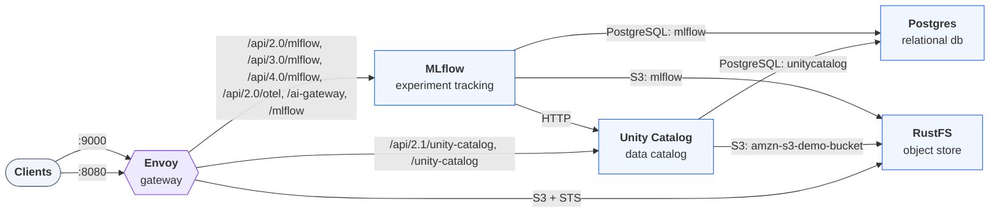

With Unity Catalog as MLflow's registry, a model involves two services.
[MLflow](https://mlflow.org "Open source platform for the ML lifecycle: experiment tracking, model registry, and deployment.") records how the model was made.
[Unity Catalog](/docs/explanation/what-is-unity-catalog/ "The open-source reference server implementing the Unity Catalog specification.") holds the
registered model, such as
`unity.model_split.linear`, and its numbered versions. The two services never
share a record. A version points back at MLflow by URI, and registering copies
the model's files into the catalog's storage. So each side keeps working when
the other side's copy is deleted.

## What MLflow tracks

MLflow keeps the training side of the model. An experiment groups runs.
A run records its parameters, such as `fit_intercept`, and its metrics, such as
`r2`. When the training code calls `log_model`, MLflow creates a *logged model*
with a URI of the form `models:/m-<id>`. A logged model has its own identity.
It belongs to a run when you log it inside an active run, and otherwise it has
no run
([`model.py`](https://github.com/mlflow/mlflow/blob/v3.17.0/mlflow/models/model.py#L1159-L1175)).
The logged model holds the files that a later load needs, such as the `MLmodel`
descriptor and the serialized model.

All of this lives in MLflow's own stores, not in the catalog. The tracking
server writes runs and logged-model metadata to its backend database, and
serves the logged model's files from its artifact store through URIs that
start with `mlflow-artifacts:/`.

## What Unity Catalog registers

Unity Catalog keeps the governed side of the model: the registered model, its
versions, their files, and who may use them.

A registered model lives in a schema next to tables, volumes, and functions,
and has a three-level name, `catalog.schema.model`. Each registration adds a
version with the next number: 1, 2, 3. A version records its `status`, a
`storage_location` for its files, and two links back to MLflow. `source` holds
the logged model's URI, `models:/m-<id>`. `run_id` holds the run's ID when you
register from a `runs:/<run-id>/<path>` URI, and stays empty when you register
from `models:/m-<id>`.

The server chooses a registered model's storage when the model is created. It
uses the schema's managed storage, or the catalog's if the schema has none
([`ModelRepository.java`](https://github.com/unitycatalog/unitycatalog/blob/v0.7.0/server/src/main/java/io/unitycatalog/server/persist/ModelRepository.java#L241-L245),
[`ExternalLocationUtils.java`](https://github.com/unitycatalog/unitycatalog/blob/v0.7.0/server/src/main/java/io/unitycatalog/server/persist/utils/ExternalLocationUtils.java#L668-L688)).
If neither has managed storage, creating the model fails. Each version then
gets its own folder under the model's location. In the `uc-mlflow`
environment, a version of a model in the `unity` catalog lands at
`s3://amzn-s3-demo-bucket/unity/__unitystorage/catalogs/<id>/models/<id>/versions/<id>`.

A registered model is a securable, so the
[privilege model](/docs/explanation/uc-basics/#ownership-and-privileges) applies to it
when authorization is enabled. The `uc-mlflow` environment runs with
authorization disabled. Creating a model takes `CREATE MODEL` on the schema.
Using one takes `EXECUTE` on the model, plus `USE SCHEMA` on its schema and
`USE CATALOG` on its catalog. Versions aren't securables of their own: the
privileges on the model cover every version.

## Where each piece is stored

In the `uc-mlflow` environment, both services share one PostgreSQL server and
one object store, but each keeps to its own database and its own bucket:

```trestle /docs/assets/trestle/uc-mlflow/diagram.trestle-graph.json
A gateway routes the Unity Catalog API to the server and the MLflow API to the tracking server, which serves its model registry from Unity Catalog. Both keep metadata in PostgreSQL (separate `unitycatalog` and `mlflow` databases) and files in RustFS (`amzn-s3-demo-bucket` and `mlflow` buckets).
```



| Object                                          | Owned by      | Metadata                | Files                                                    |
| ----------------------------------------------- | ------------- | ----------------------- | -------------------------------------------------------- |
| Experiment and run, with parameters and metrics | MLflow        | `mlflow` database       | —                                                        |
| Logged model, `models:/m-<id>`                  | MLflow        | `mlflow` database       | `mlflow` bucket, served by the tracking server           |
| Registered model                                | Unity Catalog | `unitycatalog` database | —                                                        |
| Model version                                   | Unity Catalog | `unitycatalog` database | `amzn-s3-demo-bucket` bucket, under the model's location |

Because each side keeps its own records and files, each survives the other's
deletes. Deleting a model's versions and then the model in Unity Catalog
leaves the run active, with its parameters and its logged model's files.
Deleting the run, the logged model, and the logged model's files in MLflow
leaves the version `READY`, and it still loads from Unity Catalog's storage.

## What registering a model version does

Registering a model version copies the logged model's files into a new
version, in four steps that the MLflow client drives
([`create_model_version`](https://github.com/mlflow/mlflow/blob/v3.17.0/mlflow/store/_unity_catalog/registry/uc_oss_rest_store.py#L259-L297)):

1. **Create.** The client downloads the logged model's files from the tracking
   server and asks Unity Catalog to create the version, sending its `source`
   and `run_id`. The server assigns the version number and a storage location,
   and the version starts as `PENDING_REGISTRATION`.
2. **Get credentials.** The client asks Unity Catalog for temporary
   credentials with the `READ_WRITE_MODEL_VERSION` operation, scoped to that
   version's location
   ([`uc_oss_rest_store.py`](https://github.com/mlflow/mlflow/blob/v3.17.0/mlflow/store/_unity_catalog/registry/uc_oss_rest_store.py#L433-L456)).
   [Credential vending](/docs/explanation/credential-vending/) explains how the server
   mints them.
3. **Upload.** The client writes the files to the version's location with
   those credentials.
4. **Finalize.** The client tells Unity Catalog the upload is done, and the
   version becomes `READY`.

MLflow's client reaches Unity Catalog when its registry URI is
`uc:<server URL>`, such as `uc:http://localhost:8080`. MLflow takes the server
from the URI and a bearer token, if any, from the `MLFLOW_UC_OSS_TOKEN`
environment variable
([`oss_registry_utils.py`](https://github.com/mlflow/mlflow/blob/v3.17.0/mlflow/utils/oss_registry_utils.py#L12-L29)).
The tracking URI stays separate: the Unity Catalog store
[has no tracking URI of its own](https://github.com/mlflow/mlflow/blob/v3.17.0/mlflow/store/_unity_catalog/registry/uc_oss_rest_store.py#L77-L79),
so runs and logged models stay on the tracking server.

The logged model and its files stay in MLflow's store. Loading
`models:/<catalog>.<schema>.<model>/<version>` reads the version's copy from
Unity Catalog's storage, not from MLflow's.

## What the registry doesn't do

Unity Catalog's registry, and MLflow's store for it, leave out several
features that other MLflow registries have:

- No aliases or stages. MLflow refuses to set aliases or move versions between
  stages, so `models:/<name>@<alias>` and `models:/<name>/latest` don't
  resolve. Load a version by its number instead.
- No tags. MLflow refuses to set tags on models and versions, and drops tags
  passed when registering without an error.
- No rename through MLflow. The Python SDK and the CLI rename a registered
  model.
- No serving. Registering deploys nothing, and loading runs the model in the
  loading process.

[Manage registered models](/docs/how-to/manage-models/) shows the
error each of these raises.

## What each client can do

A check links the published page whose tests prove that the client can do the
operation. A cross links the page whose tests show the client refusing it:
MLflow can't rename a model or use an alias. A dash marks a pair that no
published page tests.

| Operation                 | [uc CLI 0.7](https://docs.unitycatalog.io/how-to/run-local-server#run-the-uc-cli "Command-line client for managing Unity Catalog objects and storage access.") | [Python SDK 0.7](https://pypi.org/project/unitycatalog-client/ "Generated asynchronous Python client for Unity Catalog REST APIs.") | [MLflow 3.17](https://mlflow.org "Open source platform for the ML lifecycle: experiment tracking, model registry, and deployment.") |
| ------------------------- | -------------------------------------------------------------------------------------------------------------------------------------------------------------- | ----------------------------------------------------------------------------------------------------------------------------------- | ----------------------------------------------------------------------------------------------------------------------------------- |
| Register a model version  | —                                                                                                                                                              | —                                                                                                                                   | [✓](/docs/how-to/manage-models/#register-a-model-version)                                                                           |
| View models and versions  | [✓](/docs/how-to/manage-models/#view-models-and-versions)                                                                                                      | [✓](/docs/how-to/manage-models/#view-models-and-versions)                                                                           | [✓](/docs/how-to/manage-models/#view-models-and-versions)                                                                           |
| Load a model version      | —                                                                                                                                                              | —                                                                                                                                   | [✓](/docs/how-to/manage-models/#load-a-model-version)                                                                               |
| Update a model or version | [✓](/docs/how-to/manage-models/#update-comments)                                                                                                               | [✓](/docs/how-to/manage-models/#update-comments)                                                                                    | [✓](/docs/how-to/manage-models/#update-comments)                                                                                    |
| Rename a registered model | [✓](/docs/how-to/manage-models/#rename-a-model)                                                                                                                | [✓](/docs/how-to/manage-models/#rename-a-model)                                                                                     | [✗](/docs/how-to/manage-models/#rename-a-model)                                                                                     |
| Delete a model version    | [✓](/docs/how-to/manage-models/#delete-a-version)                                                                                                              | [✓](/docs/how-to/manage-models/#delete-a-version)                                                                                   | [✓](/docs/how-to/manage-models/#delete-a-version)                                                                                   |
| Delete a registered model | [✓](/docs/how-to/manage-models/#delete-a-model)                                                                                                                | [✓](/docs/how-to/manage-models/#delete-a-model)                                                                                     | [✓](/docs/how-to/manage-models/#delete-a-model)                                                                                     |
| Use a model alias         | —                                                                                                                                                              | —                                                                                                                                   | [✗](/docs/how-to/manage-models/#load-a-model-version)                                                                               |

## Next steps

- [Register and reload a model with MLflow](/docs/tutorials/register-model-mlflow/)
  to log, register, and load a model on the `uc-mlflow` stack.
- [Manage registered models](/docs/how-to/manage-models/) to view,
  update, rename, and delete models and versions.
- [Learn how credential vending works](/docs/explanation/credential-vending/), the
  mechanism behind a version's upload and load.
- [Learn the core concepts](/docs/explanation/uc-basics/) to see where registered
  models sit in the namespace and the privilege model.
