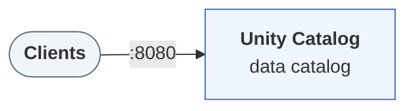

In this tutorial you define three business metrics, the order count, total
revenue, and revenue per customer, once, as a *metric view* in Unity Catalog.
Then you query them sliced three different ways without writing an
aggregation yourself. Everyone who queries the view gets the same numbers,
because the definition lives in the catalog, not in each query.

Allow about fifteen minutes.

:::prerequisites
- [Docker](https://docs.docker.com/get-started/get-docker/) with Compose v2, for the local environment.
- [uv](https://docs.astral.sh/uv/getting-started/installation/).
- [Java 17](https://adoptium.net/temurin/releases/?version=17).
:::

:::journey
## Start the environment

Download the docs' environment and start Unity Catalog 0.7.0. Already running it? Skip this.

```bash
curl -fsSL https://unitycatalog.io/docs/env/unitycatalog.tar.gz | tar -xz
cd uc-docs-env/unitycatalog && docker compose up -d --wait
export UNITY_CATALOG_URL=http://localhost:8080/api/2.1/unity-catalog
```

```trestle /docs/assets/trestle/unitycatalog/diagram.trestle-graph.json
The services Unity Catalog 0.7.0 runs and how clients reach them
```



Stop it later with `docker compose down` from `uc-docs-env/unitycatalog`.

## Open a Python session

Metric views need Spark 4.2. Open a Python session
with PySpark 4.2, from a terminal where `UC_DOCS_ROOT` is set the same way as
for the server:

```bash
uv run --with pyspark==4.2.0 python
```

Enter each of the following snippets in it, in order. Start Spark with the
Unity Catalog connector for Spark 4.2 and the matching Delta Lake:

```python title="metric_view.py" script="/docs/tutorials/first-metric-view/snippets/metric_view.py"
import os

from pyspark.sql import SparkSession

spark = (
    SparkSession.builder.appName("metric-views")
    .config(
        "spark.jars.packages",
        "io.unitycatalog:unitycatalog-spark_4.2_2.13:0.7.0,"
        "io.delta:delta-spark_4.2_2.13:4.4.1",
    )
    .config("spark.sql.extensions", "io.delta.sql.DeltaSparkSessionExtension")
    .config(
        "spark.sql.catalog.spark_catalog",
        "org.apache.spark.sql.delta.catalog.DeltaCatalog",
    )
    .config("spark.sql.catalog.unity", "io.unitycatalog.spark.UCSingleCatalog")
    .config("spark.sql.catalog.unity.uri", "http://localhost:8080")
    .config("spark.sql.catalog.unity.auth.type", "static")
    .config("spark.sql.catalog.unity.auth.token", "not-used")
    .config("spark.sql.defaultCatalog", "unity")
    .getOrCreate()
)
```

The first run takes a minute while Spark downloads the jars.
[Configure Spark to use Unity Catalog](/docs/how-to/configure-spark/)
explains each setting.

## Create the orders table

A metric view computes over a source: a table, a view, or a query. Create a
schema and a small Delta table of orders in the server's
[shared folder](/docs/how-to/run-local-server/#share-a-folder-with-the-server):

```python title="metric_view.py" script="/docs/tutorials/first-metric-view/snippets/metric_view.py"
DOCS_ROOT = os.environ.get("UC_DOCS_ROOT", "/tmp/uc-docs")

spark.sql("CREATE SCHEMA shop")
spark.sql(f"""
    CREATE TABLE shop.orders (
        order_id   BIGINT,
        customer   STRING,
        status     STRING,
        order_date DATE,
        amount     DECIMAL(10, 2)
    ) USING DELTA
    LOCATION '{DOCS_ROOT}/shop/orders'
""")
spark.sql("""
    INSERT INTO shop.orders VALUES
        (1, 'ada',      'F', DATE'2026-01-05', 100.00),
        (2, 'grace',    'O', DATE'2026-01-12',  40.00),
        (3, 'ada',      'F', DATE'2026-01-20',  60.00),
        (4, 'linus',    'P', DATE'2026-01-28',  25.00),
        (5, 'grace',    'F', DATE'2026-02-02',  80.00),
        (6, 'ada',      'O', DATE'2026-02-10',  30.00),
        (7, 'margaret', 'F', DATE'2026-02-18', 120.00),
        (8, 'linus',    'F', DATE'2026-02-25',  45.00)
""")
```

## Define the metric view

The definition is YAML inside a `CREATE VIEW … WITH METRICS` statement. Its
`source` names the table. The `dimensions` are the values you group and filter
by, each an expression on a source row. The `measures` are the aggregations
you report:

```python title="metric_view.py" script="/docs/tutorials/first-metric-view/snippets/metric_view.py"
spark.sql("""
CREATE VIEW shop.orders_metrics
WITH METRICS
LANGUAGE YAML
AS $$
version: "0.1"
source: unity.shop.orders
dimensions:
  - name: Order Month
    expr: DATE_TRUNC('MONTH', order_date)
  - name: Order Status
    expr: |-
      CASE status
        WHEN 'O' THEN 'Open'
        WHEN 'P' THEN 'Processing'
        WHEN 'F' THEN 'Fulfilled'
      END
measures:
  - name: Order Count
    expr: COUNT(1)
  - name: Total Revenue
    expr: SUM(amount)
  - name: Revenue per Customer
    expr: ROUND(SUM(amount) / COUNT(DISTINCT customer), 2)
$$
""")
```

Names can be the ones your reports use, spaces included. Quote them with
backticks in queries. The definition starts with `version: "0.1"`, the only
version Spark reads.

## Inspect it

The view's columns are its dimensions followed by its measures, and its type
is `METRIC_VIEW`:

```python title="metric_view.py" script="/docs/tutorials/first-metric-view/snippets/metric_view.py"
spark.sql("DESCRIBE shop.orders_metrics").show()
spark.sql("DESCRIBE EXTENDED shop.orders_metrics").where("col_name = 'Type'").show()
```

```text
+--------------------+-------------+-------+
|            col_name|    data_type|comment|
+--------------------+-------------+-------+
|         Order Month|    timestamp|   NULL|
|        Order Status|       string|   NULL|
|         Order Count|       bigint|   NULL|
|       Total Revenue|decimal(20,2)|   NULL|
|Revenue per Customer|decimal(21,2)|   NULL|
+--------------------+-------------+-------+

+--------+-----------+-------+
|col_name|  data_type|comment|
+--------+-----------+-------+
|    Type|METRIC_VIEW|       |
+--------+-----------+-------+
```

The catalog stores the YAML. Spark reads it back each time you query the
view.

## Query measures by month

Wrap each measure in `MEASURE()` and group by the dimensions you want:

```python title="metric_view.py" script="/docs/tutorials/first-metric-view/snippets/metric_view.py"
spark.sql("""
    SELECT
      `Order Month`,
      MEASURE(`Order Count`),
      MEASURE(`Total Revenue`),
      MEASURE(`Revenue per Customer`)
    FROM shop.orders_metrics
    GROUP BY ALL
    ORDER BY `Order Month`
""").show()
```

```text
+-------------------+--------------------+----------------------+-----------------------------+
|        Order Month|measure(Order Count)|measure(Total Revenue)|measure(Revenue per Customer)|
+-------------------+--------------------+----------------------+-----------------------------+
|2026-01-01 00:00:00|                   4|                225.00|                        75.00|
|2026-02-01 00:00:00|                   4|                275.00|                        68.75|
+-------------------+--------------------+----------------------+-----------------------------+
```

Spark turns each `MEASURE()` into the measure's expression, aggregated over
the source rows in each group. The result is what you'd get by writing the
`GROUP BY` against `shop.orders` yourself. Reading a measure column without
`MEASURE()` fails.

## Slice them differently

Filter on one dimension and group by another, or leave out `GROUP BY` for the
total:

```python title="metric_view.py" script="/docs/tutorials/first-metric-view/snippets/metric_view.py"
spark.sql("""
    SELECT `Order Status`, MEASURE(`Total Revenue`)
    FROM shop.orders_metrics
    WHERE `Order Month` = DATE'2026-02-01'
    GROUP BY ALL
    ORDER BY `Order Status`
""").show()
spark.sql("""
    SELECT MEASURE(`Revenue per Customer`) FROM shop.orders_metrics
""").show()
```

```text
+------------+----------------------+
|Order Status|measure(Total Revenue)|
+------------+----------------------+
|   Fulfilled|                245.00|
|        Open|                 30.00|
+------------+----------------------+

+-----------------------------+
|measure(Revenue per Customer)|
+-----------------------------+
|                       125.00|
+-----------------------------+
```

Revenue per customer over both months is 125.00, not the average of 75.00 and
68.75: four customers spent 500.00 in total. Spark computes each measure from
the source rows, never from other results, so a ratio like this one stays
right however you slice it.

## Clean up

Drop the metric view, the table, and the schema, and stop Spark. Then leave the
session with `Ctrl+D`:

```python title="metric_view.py" script="/docs/tutorials/first-metric-view/snippets/metric_view.py"
spark.sql("DROP VIEW shop.orders_metrics")
spark.sql("DROP TABLE shop.orders")
spark.sql("DROP SCHEMA shop")
spark.stop()
```

Dropping the metric view leaves its source table in place. `shop.orders` is
an external table, so its files stay in `UC_DOCS_ROOT/shop` after the drop.
:::

## What you did

You stored three metrics in the catalog and queried them by month, by status,
and in total, without repeating their formulas. A dashboard, a notebook, or an
agent that queries `shop.orders_metrics` gets the same order count and the
same revenue per customer, because none of them define it.

## Next steps

- [Manage metric views](/docs/how-to/metric-views/)
  covers query sources, joins, registering a definition through the REST API,
  and changing one.
- [SQL views and metric views as catalog objects](/docs/explanation/views-and-metric-views/)
  explains what the catalog stores for a metric view and where it runs.
- [Seed the TPC-H sample data](/docs/how-to/seed-tpch-data/) gives you
  a larger dataset to define metrics over.
