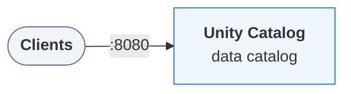

In this tutorial you create a Delta table that Unity Catalog *manages*: the
catalog picks where its files live and approves every change to it. You write
it with plain Spark SQL, change some rows, look back at an earlier version,
and finally drop it. Along the way you see what makes a managed table different
from a folder of Delta files.

Allow about fifteen minutes.

:::prerequisites
- [Docker](https://docs.docker.com/get-started/get-docker/) with Compose v2, for the local environment.
- [uv](https://docs.astral.sh/uv/getting-started/installation/).
- [Java 17](https://adoptium.net/temurin/releases/?version=17).
:::

::::journey
## Start the environment

Download the docs' environment and start Unity Catalog 0.7.0. Already running it? Skip this.

```bash
curl -fsSL https://unitycatalog.io/docs/env/unitycatalog.tar.gz | tar -xz
cd uc-docs-env/unitycatalog && docker compose up -d --wait
export UNITY_CATALOG_URL=http://localhost:8080/api/2.1/unity-catalog
```

```trestle /docs/assets/trestle/unitycatalog/diagram.trestle-graph.json
The services Unity Catalog 0.7.0 runs and how clients reach them
```



Stop it later with `docker compose down` from `uc-docs-env/unitycatalog`.

## Open a Python session

Spark on your machine writes the
table's files under the server's
[shared folder](/docs/how-to/run-local-server/#share-a-folder-with-the-server),
`UC_DOCS_ROOT`. The server needs to see them too, because it deletes them when
you drop the table.

Open a Python session with PySpark and the Unity Catalog client, from a
terminal where `UC_DOCS_ROOT` is set the same way as for the server:

```bash
uv run --with pyspark==4.1.0 --with unitycatalog-client==0.7.0 python
```

Enter each of the following snippets in it, in order, starting with the
imports:

```python title="managed_table.py" script="/docs/tutorials/managed-delta-table/snippets/managed_table.py"
import asyncio
import os

from pyspark.sql import SparkSession
from unitycatalog.client import ApiClient, CatalogsApi, Configuration, CreateCatalog

```

## Give a catalog managed storage

A managed table needs somewhere to live. Create a catalog with a
*storage root*, the location under which Unity Catalog places the files of
every managed table and volume in the catalog:

```python title="managed_table.py" script="/docs/tutorials/managed-delta-table/snippets/managed_table.py"
DOCS_ROOT = os.environ.get("UC_DOCS_ROOT", "/tmp/uc-docs")


async def create_catalog() -> None:
    config = Configuration(host="http://localhost:8080/api/2.1/unity-catalog")
    async with ApiClient(config) as api:
        catalog = await CatalogsApi(api).create_catalog(
            CreateCatalog(name="retail", storage_root=f"file://{DOCS_ROOT}/managed")
        )
        print(catalog.storage_location)


asyncio.run(create_catalog())
```

The output is the catalog's own folder under that root, ending in
`__unitystorage/catalogs/<catalog-id>`. Unity Catalog chooses these paths. You
never pick one for a managed table.

## Connect Spark

Start a Spark session that knows the `retail` catalog:

```python title="managed_table.py" script="/docs/tutorials/managed-delta-table/snippets/managed_table.py"
spark = (
    SparkSession.builder.appName("managed-orders")
    .config(
        "spark.jars.packages",
        "io.unitycatalog:unitycatalog-spark_4.1_2.13:0.7.0,"
        "io.delta:delta-spark_4.1_2.13:4.3.1",
    )
    .config("spark.sql.extensions", "io.delta.sql.DeltaSparkSessionExtension")
    .config(
        "spark.sql.catalog.spark_catalog",
        "org.apache.spark.sql.delta.catalog.DeltaCatalog",
    )
    .config("spark.sql.catalog.retail", "io.unitycatalog.spark.UCSingleCatalog")
    .config("spark.sql.catalog.retail.uri", "http://localhost:8080")
    .config("spark.sql.catalog.retail.auth.type", "static")
    .config("spark.sql.catalog.retail.auth.token", "not-used")
    .config("spark.sql.defaultCatalog", "retail")
    .getOrCreate()
)
```

The first run takes a minute while Spark downloads the jars.
[Configure Spark to use Unity Catalog](/docs/how-to/configure-spark/)
explains each setting.

## Create the table

Create a schema and a table in it. Leaving out a `LOCATION` is what makes the
table managed:

```python title="managed_table.py" script="/docs/tutorials/managed-delta-table/snippets/managed_table.py"
spark.sql("CREATE SCHEMA sales")
spark.sql("""
    CREATE TABLE sales.orders (
        order_id BIGINT,
        customer STRING,
        amount   DECIMAL(10, 2)
    ) USING DELTA
""")
```

Behind this statement, Spark asks the server to reserve a table. The server
returns a location and a short-lived credential to write there. Spark writes the
first Delta log entry, then asks the server to make the table official.

## Write some rows

Insert three orders and read them back:

```python title="managed_table.py" script="/docs/tutorials/managed-delta-table/snippets/managed_table.py"
spark.sql("""
    INSERT INTO sales.orders VALUES
        (1, 'ada', 9.50),
        (2, 'grace', 20.00),
        (3, 'linus', 3.25)
""")
spark.table("sales.orders").orderBy("order_id").show()
```

```text
+--------+--------+------+
|order_id|customer|amount|
+--------+--------+------+
|       1|     ada|  9.50|
|       2|   grace| 20.00|
|       3|   linus|  3.25|
+--------+--------+------+
```

## See where the table lives

Ask Delta for the table's location and for the property that marks it as
catalog-managed:

```python title="managed_table.py" script="/docs/tutorials/managed-delta-table/snippets/managed_table.py"
detail = spark.sql("DESCRIBE DETAIL sales.orders").first()
print(detail.location)
print(
    spark.sql(
        "SHOW TBLPROPERTIES sales.orders ('delta.feature.catalogManaged')"
    ).first()
)
```

```text
file:/tmp/uc-docs/managed/__unitystorage/catalogs/<catalog-id>/tables/<table-id>
Row(key='delta.feature.catalogManaged', value='supported')
```

You didn't set `delta.feature.catalogManaged` yourself. The connector adds it
when it creates a managed table. It tells every Delta client that the catalog,
not the files, has the final say on the table's latest version.

## Change rows

Update one order and delete another, then list the table's history:

```python title="managed_table.py" script="/docs/tutorials/managed-delta-table/snippets/managed_table.py"
spark.sql("UPDATE sales.orders SET amount = 25.00 WHERE order_id = 2")
spark.sql("DELETE FROM sales.orders WHERE customer = 'linus'")
spark.sql("DESCRIBE HISTORY sales.orders").select("version", "operation").show()
```

```text
+-------+------------+
|version|   operation|
+-------+------------+
|      3|      DELETE|
|      2|      UPDATE|
|      1|       WRITE|
|      0|CREATE TABLE|
+-------+------------+
```

Each statement became one new version. For each one, Spark wrote the change to
storage and then asked the server to accept it as the next version. If two
writers race for the same version, the server accepts exactly one of them.

## Read an earlier version

Delta keeps old versions, so you can still count the orders as they were before
the update and the delete:

```python title="managed_table.py" script="/docs/tutorials/managed-delta-table/snippets/managed_table.py"
spark.sql("SELECT count(*) AS orders FROM sales.orders VERSION AS OF 1").show()
```

```text
+------+
|orders|
+------+
|     3|
+------+
```

## Clean up

Drop the table and the schema, and stop Spark. Then leave the session with
`Ctrl+D`:

```python title="managed_table.py" script="/docs/tutorials/managed-delta-table/snippets/managed_table.py"
spark.sql("DROP TABLE sales.orders")
spark.sql("DROP SCHEMA sales")
spark.stop()
```

:::warning
Dropping a managed table deletes its files once
`server.storage-cleanup.initial-delay` passes, 7 days by default. The table
can't be restored in the meantime. This is the opposite of an
[external table](/docs/how-to/register-external-table/), whose files
stay where they are.
:::

To run the tutorial again, delete the `retail` catalog first:
`uc catalog delete --name retail --force true`, with the `uc` shortcut from
[Create your first catalog](/docs/tutorials/getting-started/#define-a-shortcut-for-the-cli).
::::

## What you did

You created a table without choosing where it lives, changed it three times, and
read it as it was two versions ago, all with ordinary Spark SQL. Unity Catalog
chose the location, handed Spark credentials for it, and approved each new
version. Any other engine that speaks the same protocol sees exactly those
versions. To try that, read the table from DuckDB.

## Next steps

- [Read and write Unity Catalog tables from DuckDB](/docs/how-to/duckdb/)
  reads and appends to a managed table from a second engine.
- [External tables and catalog-managed Delta tables](/docs/explanation/external-and-managed-tables/)
  explains the protocol behind each step.
- [Manage catalogs and schemas](/docs/how-to/manage-catalogs-and-schemas/)
  covers storage roots for schemas as well as catalogs.
