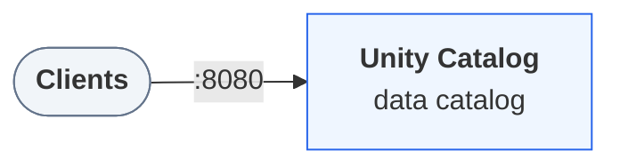

In this tutorial you register a folder of documents as a Unity Catalog
*volume*, then read those files the way any other application would, knowing
only the volume's name. On the way you see the three steps every volume reader
takes: look up where the files live, ask the catalog for access, and open them
with a storage library.

It takes about ten minutes.

:::prerequisites
- [Docker](https://docs.docker.com/get-started/get-docker/) with Compose v2, for the local environment.
- [uv](https://docs.astral.sh/uv/getting-started/installation/).
:::

::::journey
## Start the environment

Download the docs' environment and start Unity Catalog 0.7.0. Already running it? Skip this.

```bash
curl -fsSL https://unitycatalog.io/docs/env/unitycatalog.tar.gz | tar -xz
cd uc-docs-env/unitycatalog && docker compose up -d --wait
export UNITY_CATALOG_URL=http://localhost:8080/api/2.1/unity-catalog
```

```trestle /docs/assets/trestle/unitycatalog/diagram.trestle-graph.json
The services Unity Catalog 0.7.0 runs and how clients reach them
```



Stop it later with `docker compose down` from `uc-docs-env/unitycatalog`.

## Open a Python session

Open a Python session with the
Unity Catalog client and [obstore](https://developmentseed.org/obstore/), a
Python library for object storage and local files:

```bash
uv run --with unitycatalog-client==0.7.0 --with obstore==0.11.1 python -m asyncio
```

Enter each of the following snippets in it, in order.

:::note
`python -m asyncio` is a Python shell that accepts `await` at the top level,
which the asynchronous client needs.
:::

## Connect to the server

```python title="volume_files.py" script="/docs/tutorials/read-volume-files/snippets/volume_files.py"
from pathlib import Path

import obstore
from unitycatalog.client import (
    ApiClient,
    CatalogsApi,
    Configuration,
    CreateCatalog,
    CreateSchema,
    CreateVolumeRequestContent,
    GenerateTemporaryVolumeCredential,
    SchemasApi,
    TemporaryCredentialsApi,
    VolumeOperation,
    VolumesApi,
    VolumeType,
)

config = Configuration(host="http://localhost:8080/api/2.1/unity-catalog")
api = ApiClient(config)
```

Authorization is off on the local server, so the client needs no token.

## Put some files in a folder

Write three short policy documents into a folder. In a real setup these files
already exist, in cloud storage or on a shared file system:

```python title="volume_files.py" script="/docs/tutorials/read-volume-files/snippets/volume_files.py"
folder = Path("/tmp/uc-tutorial/policies")
folder.mkdir(parents=True, exist_ok=True)
(folder / "returns.md").write_text(
    "Items can be returned within 30 days of delivery.\n"
)
(folder / "shipping.md").write_text("Orders ship within two business days.\n")
(folder / "warranty.md").write_text("Electronics carry a one-year warranty.\n")
```

## Register the folder as a volume

Create a catalog and a schema, then an *external* volume that points at the
folder:

```python title="volume_files.py" script="/docs/tutorials/read-volume-files/snippets/volume_files.py"
await CatalogsApi(api).create_catalog(CreateCatalog(name="support"))
await SchemasApi(api).create_schema(
    CreateSchema(name="knowledge", catalog_name="support")
)
await VolumesApi(api).create_volume(
    CreateVolumeRequestContent(
        catalog_name="support",
        schema_name="knowledge",
        name="policies",
        volume_type=VolumeType.EXTERNAL,
        storage_location=folder.as_uri(),
        comment="Customer-facing policy documents",
    )
)
```

The server only records the location. It neither copies nor checks the files,
which is why the folder doesn't have to be visible inside the server's
container. From now on, the files have a governed name:
`support.knowledge.policies`.

## Find the volume by name

Now switch roles. You are an application that knows only the name. Ask the
catalog for the volume:

```python title="volume_files.py" script="/docs/tutorials/read-volume-files/snippets/volume_files.py"
volume = await VolumesApi(api).get_volume(name="support.knowledge.policies")
print(volume.full_name, volume.volume_type.value)
print(volume.storage_location)
```

The output shows `support.knowledge.policies EXTERNAL` and the folder's
`file://` location.

## Ask for access

Before reading, request temporary credentials for the volume, naming what you
want to do with it:

```python title="volume_files.py" script="/docs/tutorials/read-volume-files/snippets/volume_files.py"
creds = await TemporaryCredentialsApi(
    api
).generate_temporary_volume_credentials(
    GenerateTemporaryVolumeCredential(
        volume_id=volume.volume_id,
        operation=VolumeOperation.READ_VOLUME,
    )
)
print(creds.url)
print(creds.aws_temp_credentials, creds.expiration_time)  # None None
```

This is the request the catalog can refuse. With authorization enabled, the
server answers only if you may use the catalog and schema (`USE CATALOG`,
`USE SCHEMA`) and read the volume (`READ VOLUME`), or own them. On S3, ADLS,
or GCS the answer holds short-lived keys that work only for this volume's
location, plus their expiry. That process is called
[credential vending](/docs/explanation/credential-vending/). Local files
need no keys, so here the answer carries only the location and both values
print as `None`.

## Open the volume's storage

Define a small function that turns the answer into a storage client:

```python title="volume_files.py" script="/docs/tutorials/read-volume-files/snippets/volume_files.py"
from obstore.store import from_url
from unitycatalog.client import TemporaryCredentials


def open_store(creds: TemporaryCredentials):
    """Open the volume's directory with the credentials Unity Catalog vended."""
    if creds.aws_temp_credentials:
        aws = creds.aws_temp_credentials
        return from_url(
            creds.url,
            access_key_id=aws.access_key_id,
            secret_access_key=aws.secret_access_key,
            session_token=aws.session_token,
        )
    return from_url(creds.url)  # local storage: no credentials needed


```

With vended AWS keys, the function passes them to obstore. Otherwise, it opens
the location directly. Your reading code stays the same either way.

## Read the files

List the volume's files and read each one:

```python title="volume_files.py" script="/docs/tutorials/read-volume-files/snippets/volume_files.py"
store = open_store(creds)
for meta in sorted(obstore.list(store).collect(), key=lambda m: m["path"]):
    text = bytes(obstore.get(store, meta["path"]).bytes()).decode()
    print(f"{meta['path']} ({meta['size']} bytes): {text.strip()}")
```

The output shows the three documents and their sizes:

```text
returns.md (50 bytes): Items can be returned within 30 days of delivery.
shipping.md (38 bytes): Orders ship within two business days.
warranty.md (39 bytes): Electronics carry a one-year warranty.
```

## Clean up

Delete the catalog, and with it the schema and the volume:

```python title="volume_files.py" script="/docs/tutorials/read-volume-files/snippets/volume_files.py"
await CatalogsApi(api).delete_catalog(name="support", force=True)
print(sorted(p.name for p in folder.iterdir()))  # the files are still there
await api.close()
```

Deleting an external volume removes only the catalog's record. The folder and
its files stay where they are, so the last line lists all three. Leave the
session with `Ctrl+D`.
::::

## What you did

You gave a folder of files a governed name. Then, as a reader that knew only the
name, you asked Unity Catalog where the files are and for permission to read
them. Finally, you read them directly from storage. The catalog never served a
byte of the files. It handed out the location and the permission, and the data
came straight from storage.

## Next steps

- [Manage volumes](/docs/how-to/manage-volumes/) covers
  managed volumes, renaming, and what deleting each kind does to its files.
- [Credential vending](/docs/explanation/credential-vending/) explains
  the trust boundary behind the access request.
