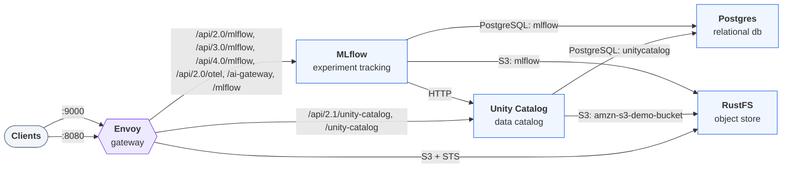

Two services share the work in this tutorial. MLflow keeps the run and the
model you log in it. Unity Catalog keeps the
[registered model](/docs/explanation/models-and-mlflow/ "A governed ML model.") and its versions, under a
three-part name like a table.

:::prerequisites
- [Docker](https://docs.docker.com/get-started/get-docker/) with Compose v2, for the local environment.
- [uv](https://docs.astral.sh/uv/getting-started/installation/)
:::

::::journey
## Start the environment

Download the docs' environment and start Unity Catalog 0.7.0 with MLflow, simulated S3, and PostgreSQL. Already running it? Skip this.

```bash
curl -fsSL https://unitycatalog.io/docs/env/uc-mlflow.tar.gz | tar -xz
cd uc-docs-env/uc-mlflow && docker compose up -d --wait
export AWS_ALLOW_HTTP=true
export AWS_ENDPOINT_URL=http://localhost:9000
export AWS_ENDPOINT_URL_S3=http://localhost:9000
export AWS_REGION=us-east-1
export MLFLOW_AI_GATEWAY_URL=http://localhost:8080/ai-gateway
export MLFLOW_ENABLE_PROXY_MULTIPART_DOWNLOAD=false
export MLFLOW_ENABLE_PROXY_MULTIPART_UPLOAD=false
export MLFLOW_REGISTRY_URI=uc:http://localhost:8080
export MLFLOW_TRACKING_URI=http://localhost:8080
export UNITY_CATALOG_URL=http://localhost:8080/api/2.1/unity-catalog
```

```trestle /docs/assets/trestle/uc-mlflow/diagram.trestle-graph.json
The services Unity Catalog 0.7.0 with MLflow, simulated S3, and PostgreSQL runs and how clients reach them
```



Stop it later with `docker compose down` from `uc-docs-env/uc-mlflow`.

## Open a Python session

Open a Python session with MLflow, the Unity Catalog client, and scikit-learn:

```bash
uv run --python 3.12 --with mlflow==3.17.0 --with boto3==1.43.114 --with unitycatalog-client==0.7.0 --with scikit-learn==1.9.1 python -m asyncio
```

Enter each of the following snippets in the session, in order.

:::note
MLflow's Unity Catalog registry is part of the `mlflow` package. It reads and
writes a version's files in the catalog's S3 storage with boto3, which `mlflow`
doesn't install on its own.
:::

:::note
`python -m asyncio` is a Python shell that accepts `await` at the top level,
which the asynchronous Unity Catalog client needs.
:::

## Point MLflow at both services

Set the tracking server, the model registry, and the address of the object
storage. The `uc:` prefix on the registry URI selects MLflow's Unity Catalog
registry:

```python title="hello_mlflow.py" script="/docs/tutorials/register-model-mlflow/snippets/hello_mlflow.py"
import os

import mlflow

os.environ["AWS_ENDPOINT_URL_S3"] = "http://localhost:9000"
os.environ["MLFLOW_ENABLE_PROXY_MULTIPART_DOWNLOAD"] = "false"
os.environ["MLFLOW_ENABLE_PROXY_MULTIPART_UPLOAD"] = "false"
mlflow.set_tracking_uri("http://localhost:8080")
mlflow.set_registry_uri("uc:http://localhost:8080")
```

:::note
MLflow configures tracking and the registry separately. Here both URIs reach
`localhost:8080`, which routes each request to the right service.
`AWS_ENDPOINT_URL_S3` is the only storage setting the session needs. MLflow
reads and writes the version's files in the catalog's storage directly, and
this variable points it at the local S3-compatible store instead of AWS.

The two `MLFLOW_ENABLE_PROXY_MULTIPART_*` settings are only for the Docker
Compose environment: without them, the tracking server hands out download links
for an address inside it that your machine can't reach. A real deployment
doesn't need them.
:::

## Create a schema for the model

A registered model lives in a schema, like a table. Create the schema
`unity.hello` in the `unity` catalog:

```python title="hello_mlflow.py" script="/docs/tutorials/register-model-mlflow/snippets/hello_mlflow.py"
from unitycatalog.client import ApiClient, Configuration, CreateSchema, SchemasApi

api = ApiClient(Configuration(host="http://localhost:8080/api/2.1/unity-catalog"))
schema = await SchemasApi(api).create_schema(
    CreateSchema(name="hello", catalog_name="unity")
)
print(schema.full_name)
```

The session prints `unity.hello`. The `unity` catalog has managed storage,
which
[creating a registered model needs](/docs/explanation/models-and-mlflow/#what-unity-catalog-registers).

## Train a small model

Fit a linear regression on five points of y = 2x + 1:

```python title="hello_mlflow.py" script="/docs/tutorials/register-model-mlflow/snippets/hello_mlflow.py"
import pandas as pd
from sklearn.linear_model import LinearRegression

X = pd.DataFrame({"x": [0.0, 1.0, 2.0, 3.0, 4.0]})
y = 2 * X["x"] + 1
model = LinearRegression().fit(X, y)
```

## Log it with a signature

Infer the model's signature from the training data, then log the model in an
MLflow run:

```python title="hello_mlflow.py" script="/docs/tutorials/register-model-mlflow/snippets/hello_mlflow.py"
from mlflow.models import infer_signature

signature = infer_signature(X, model.predict(X))
experiment = mlflow.set_experiment("hello-mlflow")
with mlflow.start_run() as run:
    info = mlflow.sklearn.log_model(
        model,
        name="linear",
        signature=signature,
        input_example=X.head(2),
        pip_requirements=["mlflow==3.17.0", "scikit-learn==1.9.1"],
    )

print(info.model_id)
```

Enter the snippet as shown. MLflow prints links to the run and the experiment,
then the logged model's id, which starts with `m-`.

`pip_requirements` lists the model's dependencies explicitly, so MLflow
doesn't record the packages of whatever project the session runs in.

:::note
A `Failed to resolve installed pip version` warning is harmless: the uv
environment has no pip.
:::

:::tip
The signature records the model's input and output schema: here one `double`
column `x` in and a prediction out. The registered version keeps it, so anyone
who loads the model can see what it expects.
:::

## Register it in Unity Catalog

Register the logged model under a three-part name:

```python title="hello_mlflow.py" script="/docs/tutorials/register-model-mlflow/snippets/hello_mlflow.py"
version = mlflow.register_model(info.model_uri, "unity.hello.linear")
print(version.name, version.version)
```

MLflow reports `Successfully registered model 'unity.hello.linear'.` and that
it created version `1`, then the session prints:

```text
unity.hello.linear 1
```

This step, and the next two, also show download and upload progress bars.

:::note
Registering copies the logged model's files into the catalog's managed
storage. MLflow writes them with temporary credentials that Unity Catalog
vends for that one model version.
:::

## See where each service keeps it

Print where the logged model's files are and where the model version's copy
is:

```python title="hello_mlflow.py" script="/docs/tutorials/register-model-mlflow/snippets/hello_mlflow.py"
from mlflow import MlflowClient

client = MlflowClient()
logged = mlflow.get_logged_model(info.model_id)
print("logged model: ", logged.artifact_location)
print(
    "model version:",
    client.get_model_version_download_uri("unity.hello.linear", "1"),
)
```

The output has two lines:

```text
logged model:  mlflow-artifacts:/<experiment-id>/models/m-<id>/artifacts
model version: s3://amzn-s3-demo-bucket/unity/__unitystorage/catalogs/<uuid>/models/<uuid>/versions/<uuid>
```

The logged model's files go through the tracking server, which stores them.
The version's copy is in the `unity` catalog's managed storage, at a path that
names the catalog, the model, and the version by id.

## Load the version and predict

Load version `1` by its registered name and predict y for x = 10:

```python title="hello_mlflow.py" script="/docs/tutorials/register-model-mlflow/snippets/hello_mlflow.py"
loaded = mlflow.pyfunc.load_model("models:/unity.hello.linear/1")
print(loaded.metadata.signature)
print(loaded.predict(pd.DataFrame({"x": [10.0]})))
```

The signature lists `['x': double (required)]` as the input and
`[Tensor('float64', (-1,))]` as the output. The prediction is `[21.]`.

:::tip
Load a model by its version number. Unity Catalog's registry has no aliases or
stages.
:::

## Clean up

Delete the version, then the model, then the schema, and close the client:

```python title="hello_mlflow.py" script="/docs/tutorials/register-model-mlflow/snippets/hello_mlflow.py"
client.delete_model_version("unity.hello.linear", "1")
client.delete_registered_model("unity.hello.linear")
await SchemasApi(api).delete_schema(full_name="unity.hello")
await api.close()
```

The session echoes `'200 OK'` for the schema. The run and the logged model's
files stay in MLflow. Leave the session with `Ctrl+D`.
::::

## Next steps

- [Manage registered models](/docs/how-to/manage-models/) to register
  new versions, load one by number, rename, and delete models.
- [Learn how credential vending works](/docs/explanation/credential-vending/),
  the mechanism that let MLflow write the version's files.
- [Learn how Unity Catalog and MLflow divide responsibilities](/docs/explanation/models-and-mlflow/)
  for runs, models, versions, and their files.
